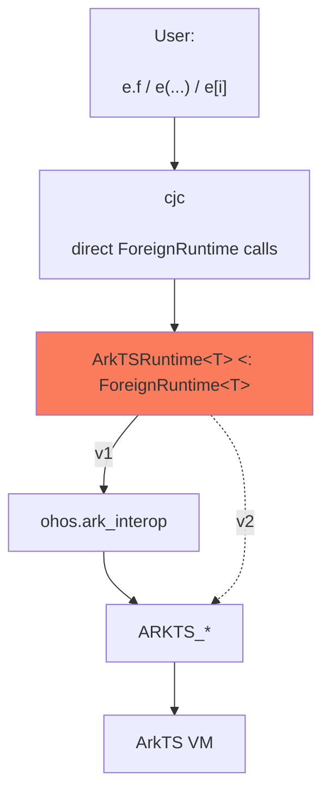
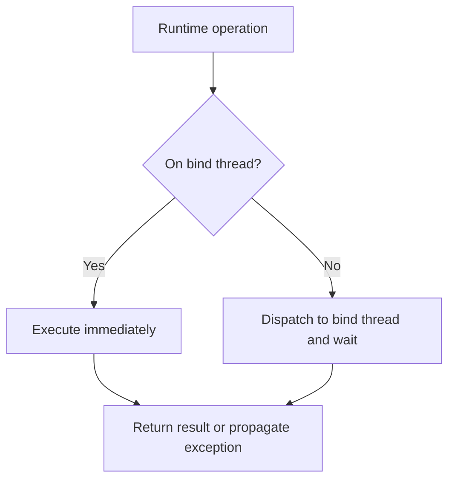

# ArkTS foreign runtime

This document specifies a generic `ArkTSRuntime<T>` foreign-runtime abstraction for accessing
ArkTS/JS values from Cangjie.

**Background.** As specified in [the simple extern model](extern_architecture_simple_model.md),
`Extern<T>` represents a value in a *foreign memory space*. It is a struct holding an opaque
`Any` payload, accessible through `Extern<T>.getPayload`. The compiler lowers dynamic
syntax to direct static calls on `T`. The type parameter `T` implements `ForeignRuntime<T>`.

Version 1 uses `ohos.ark_interop` as its backend. A later version will replace that backend
with direct Cangjie FFI bindings to OpenHarmony's native `ARKTS_*` interface.

## 1. Layering

User-facing dynamic syntax on `Extern<T>` never calls the VM directly. The compiler calls
the corresponding `ForeignRuntime<T>` method for each operation. `ArkTSRuntime<T>` dispatches
each operation to the JS thread and stores foreign values in the `Extern<T>` payload.
This version goes through `ohos.ark_interop`; later versions
will call the `ARKTS_*` FFI functions directly.

The orange box highlights `ArkTSRuntime<T>`, the focus of this document.



Consider the following example.

```cangjie
ArkTS.bind(context)

// ...

let api: Extern<ArkTS> = ArkTS.requireArkModule("test.ets")
let blob = api.createRectangle()
blob.width = 3.0
blob.width += 2.0
let a: Float64 = (Float64)blob.area()
```

The compiler lowers the dynamic operations as follows:

```cangjie
ArkTS.bind(context)

// ...

let blob = ArkTS.functionCall(ArkTS.memberAccess(api, "createRectangle"), [])

ArkTS.memberUpdate(blob, "width", 3.0)

let $tmp1 = blob
let $tmp2 = ArkTS.memberAccess(ArkTS.memberAccess($tmp1, "width"), "+")
ArkTS.memberUpdate($tmp1, "width", ArkTS.functionCall($tmp2, [2.0]))

let a: Float64 = ArkTS.fromExtern<Float64>(
                    ArkTS.functionCall(ArkTS.memberAccess(blob, "area"), [])
                 )
```

`ArkTSRuntime<T>` must implement the functions called in the desugared code above, along with the other APIs listed below.

## 2. `ArkTSRuntime<T>` interface

`ArkTSRuntime<T>` is an abstract base class implementing `ForeignRuntime<T>`. Its public surface
is summarized below; the following sections describe its behavior.

```cangjie
class ArkTSRuntimeCannotCallInAbstract <: Exception {}

abstract public class ArkTSRuntime<T> <: ForeignRuntime<T> where T <: ArkTSRuntime<T> {
    // Context
    public static func bind(newContext: JSContext): Unit {
        throw ArkTSRuntimeCannotCallInAbstract("Cannot call bind from abstract ArkTSRuntime")
    }
    protected static func getContext(): JSContext {
        throw ArkTSRuntimeCannotCallInAbstract("Cannot call getContext from abstract ArkTSRuntime")
    }

    // Dynamic operations
    public static func memberAccess(e: Extern<T>, field: String): Extern<T> { ... }
    public static func indexedAccess(e: Extern<T>, arg: Any): Extern<T> { ... }
    public static func memberUpdate(e: Extern<T>, field: String, value: Any): Unit { ... }
    public static func indexedUpdate(e: Extern<T>, field: Any, value: Any): Unit { ... }
    public static func functionCall(e: Extern<T>, args: Array<Any>): Extern<T> { ... }

    // Conversions
    public static func fromExtern<R>(value: Extern<T>): R { ... }
    public static func toExtern<R>(value: R): Extern<T> { ... }

    // Common values
    public static func undefined(): Extern<T> { ... }
    public static func null(): Extern<T> { ... }
    public static func object(): Extern<T> { ... }
    public static func global(): Extern<T> { ... }
    public static func symbol(description!: String = ""): Extern<T> { ... }

    // Value checks
    public static func strictEqual(lhs: Extern<T>, rhs: Extern<T>): Bool { ... }
    public static func isNull(value: Extern<T>): Bool { ... }
    public static func isUndefined(value: Extern<T>): Bool { ... }

    // Own properties
    public static func objectHasProperty(value: Extern<T>, key: String): Bool { ... }
    public static func objectKeys(value: Extern<T>): Array<String> { ... }
    public static func objectDefineOwnProperty(
        value: Extern<T>,
        key: String,
        propertyValue: Any,
        isWritable!: Bool = true,
        isEnumerable!: Bool = true,
        isConfigurable!: Bool = true
    ): Bool { ... }

    // Modules
    public static func requireArkModule(specifier: String): Extern<T> { ... }
    public static func requireSystemNativeModule(
        moduleName: String,
        prefix: ?String
    ): Extern<T> { ... }
}
```

The five dynamic-operation methods, `fromExtern`, and `toExtern` form the compiler-facing
`ForeignRuntime<T>` contract. The remaining methods are ArkTS-specific entry points used
directly by applications and generated bindings.


## 3. Multiple runtime instances

We use the `@ArkTSInstance` macro to declare multiple ArkTS runtime instances, each represented
by a distinct type. The macro generates a subclass that passes its own type as `T` to
`ArkTSRuntime<T>`. Each subclass inherits the shared runtime operations and owns an independent
context binding. For example, `@ArkTSInstance(ArkTSExample)` expands to the following class
(method bodies omitted):

```cangjie
class ArkTSExample <: ArkTSRuntime<ArkTSExample> {
    private static var context: ?JSContext = None

    protected static func getContext(): JSContext {...}
    public static func bind(newContext: JSContext): Unit {...}
}
```

`JSContext` identifies one ArkTS/JS engine instance. Each generated runtime can be bound to
exactly one context:

```cangjie
@ArkTSInstance(ArkTS1)
@ArkTSInstance(ArkTS2)

ArkTS1.bind(context1)
ArkTS2.bind(context2)

let first: Extern<ArkTS1> = ArkTS1.global()
let second: Extern<ArkTS2> = ArkTS2.global()
```

`Extern<ArkTS1>` and `Extern<ArkTS2>` are different types whose operations use their respective
contexts. Values from one runtime cannot be used directly in another; transferring supported
data requires conversion through Cangjie values.

The first successful `bind` permanently installs the context. Later calls throw an
exception, even for the same context. Using an unbound runtime also throws an exception.

There is no `unbind` or context replacement. A different context requires a different
specialization. Exactly one concurrent `bind` can succeed; callers must wait for it to
complete before using the runtime.

## 4. Thread dispatch

Internal dispatcher:

```cangjie
private static func run<R>(operation: () -> R): R
```

Engine calls execute on the context's bind thread (the JS thread). Runtime operations
are synchronous to the caller: calls from the bind thread execute directly; calls from
other threads wait for execution on the bind thread. Results and exceptions return to
the calling thread.

An expression containing multiple dynamic operations dispatches each operation separately.



**Possible optimization.** If all callers are guaranteed to use the bind thread,
the runtime could omit the thread check and dispatch.

## 5. Handle model

For `ArkTSRuntime<T>`, the opaque payload of `Extern<T>` is a runtime-owned handle that
stores a backend-specific representation of a foreign value from the context bound to `T`.
The handle maintains any retained references needed to keep that value alive. The same
lifetime guarantees apply to both versions of the library, regardless of the representation.

The runtime manages this lifetime automatically. Users can store `Extern<T>` values in
variables, fields, or collections, return them from functions, and reuse them across calls
without manually retaining or releasing the underlying values. A referenced ArkTS value
remains alive while its handle is reachable from Cangjie. Copying an `Extern<T>` preserves
access to the same foreign value, without duplicating the ArkTS object.

For example, the returned handle keeps an object alive after the function that created it
returns. These examples assume `ArkTS` has already been bound to a context.

```cangjie
func createObject(): Extern<ArkTS> {
    let value: Extern<ArkTS> = ArkTS.object()
    value.label = "original"
    return value // The object remains usable after this function returns.
}

func useObject(): Unit {
    let original: Extern<ArkTS> = createObject()
    let copy: Extern<ArkTS> = original // Both handles refer to the same ArkTS object.

    copy.label = "updated"
    println((String)original.label) // Prints "updated".
}

useObject() // No manual retain or release is needed.
```

For callable properties, the handle retains both the function value and its receiver.
An extracted method therefore keeps its receiver alive for later calls, even if the original
Cangjie variable holding that receiver is no longer in use.

Using the module from the earlier rectangle example:

```cangjie
func extractArea(): Extern<ArkTS> {
    let api: Extern<ArkTS> = ArkTS.requireArkModule("test.ets")
    let rectangle: Extern<ArkTS> = api.createRectangle()
    return rectangle.area // Retains both the function and rectangle.
}

let area: Extern<ArkTS> = extractArea()
let result: Float64 = (Float64)area() // The saved rectangle is still the receiver.
```

The local `rectangle` variable is out of scope when `area()` runs, but the extracted method
keeps the underlying object alive. The user does not need to store the receiver separately.

When a handle is no longer needed, the runtime automatically releases its retained references
on the context's bind thread. This allows the ArkTS garbage collector to reclaim values that
have no other references; it does not require immediate destruction of the underlying objects.
For example, after `useObject()` returns, its local handles no longer keep the object alive.

## 6. Dynamic operations

The compiler lowers each dynamic operation to a direct static call:

```cangjie
e.f                   → T.memberAccess(e, "f")
e[i]                  → T.indexedAccess(e, i)
e.f = v               → T.memberUpdate(e, "f", v)
e[i] = v              → T.indexedUpdate(e, i, v)
e(a, b)               → T.functionCall(e, [a, b])

a.b.c                 → T.memberAccess(T.memberAccess(a, "b"), "c")
a.m(10)               → T.functionCall(T.memberAccess(a, "m"), [10])

a.b(42).c = d.e().f() → T.memberUpdate(
    T.functionCall(T.memberAccess(a, "b"), [42]),
    "c",
    T.functionCall(
        T.memberAccess(T.functionCall(T.memberAccess(d, "e"), []), "f"),
        []
    )
)
```

Arguments, indices, and update values retain their Cangjie types and are passed through
`Any`; dynamic subexpressions are evaluated before the receiving method is called.
Reads and calls return `Extern<T>` values; updates return `Unit`.

### Member access

```cangjie
public static func memberAccess(e: Extern<T>, field: String): Extern<T>
public static func memberUpdate(e: Extern<T>, field: String, value: Any): Unit
```

For supported operator names, `memberAccess` returns a callable that applies the
operator to the receiver and its argument.

### Indexed access

```cangjie
public static func indexedAccess(e: Extern<T>, arg: Any): Extern<T>
public static func indexedUpdate(e: Extern<T>, field: Any, value: Any): Unit
```

Indices may be `Int32` or `Int64` positions, `String` property names, or `Extern<T>`
values from the same runtime representing strings, symbols, or numbers. Unsupported
index types throw `ExternIndexedAccessException`.

### Calls and receivers

```cangjie
public static func functionCall(e: Extern<T>, args: Array<Any>): Extern<T>
```

`functionCall` receives only a callee value and its arguments, so it cannot distinguish
a member call from a call through an extracted function. Callable properties returned by
`memberAccess` and `indexedAccess` retain their receiver. Extracted methods therefore
keep their receiver, unlike bare JS. Functions obtained without a receiver receive
`undefined` as `this`.

```cangjie
a.m(10)           // this = a

let x = a.m
x(20)             // this = a
```

Passing a callable property back to ArkTS passes the original function. The saved
receiver applies only to Cangjie dynamic calls. Calling a non-callable value throws
`ExternFunctionAccessException`.

## 7. Conversions

A Cangjie value used where
`Extern<T>` is expected becomes `T.toExtern`, while a forced cast `(U)e` becomes
`T.fromExtern<U>(e)`.

### Type mapping

For each supported `U`, `V` denotes its mapped ArkTS type.

| Cangjie type | ArkTS type |
| --- | --- |
| `Unit` | `undefined` |
| `Bool` | `boolean` |
| `Int8` | `number` |
| `Int16` | `number` |
| `Int32` | `number` |
| `Int64` | `bigint` |
| `UInt8` | `number` |
| `UInt16` | `number` |
| `UInt32` | `number` |
| `UInt64` | `bigint` |
| `Float16` | `number` |
| `Float32` | `number` |
| `Float64` | `number` |
| `BigInt` | `bigint` |
| `String` | `string` |
| `Option<U>` | `V \| undefined` |
| `Array<U>` | `Array<V>` |

### Conversion rules

Arguments and assigned values follow the same type mapping as `toExtern`.
An `Extern<T>` from the same runtime supplies its foreign value without copying it.
Values from other runtime specializations are not accepted.

`Option<U>` converts `Some` using the mapping for `U` and `None` to `undefined`.
Arrays convert each element using its type's mapping.

### `toExtern`: Cangjie value → `Extern<T>`

```cangjie
public static func toExtern<R>(value: R): Extern<T>
```

`toExtern` converts a supported Cangjie value according to the table above. An existing
`Extern<T>` is returned unchanged, preserving any saved receiver.

### `fromExtern`: `Extern<T>` → Cangjie type `R`

```cangjie
public static func fromExtern<R>(value: Extern<T>): R
```

`fromExtern<R>` converts the foreign value to the requested Cangjie type. Converting to
`Unit` discards the value. Conversion to the same `Extern<T>` returns it unchanged,
including any saved receiver.

Unsupported or failed conversions throw `ExternConversionException`.

## 8. Helpers

These ArkTS APIs complement the compiler-facing `ForeignRuntime` methods. They follow
the same threading and value-lifetime rules.

```cangjie
// Common values
public static func undefined(): Extern<T>
public static func null(): Extern<T>
public static func object(): Extern<T>
public static func global(): Extern<T>
public static func symbol(description!: String = ""): Extern<T>

// Value checks
public static func strictEqual(lhs: Extern<T>, rhs: Extern<T>): Bool
public static func isNull(value: Extern<T>): Bool
public static func isUndefined(value: Extern<T>): Bool

// Own properties
public static func objectHasProperty(value: Extern<T>, key: String): Bool
public static func objectKeys(value: Extern<T>): Array<String>
public static func objectDefineOwnProperty(
    value: Extern<T>,
    key: String,
    propertyValue: Any,
    isWritable!: Bool = true,
    isEnumerable!: Bool = true,
    isConfigurable!: Bool = true
): Bool

// Modules
public static func requireArkModule(specifier: String): Extern<T>
public static func requireSystemNativeModule(
    moduleName: String,
    prefix: ?String
): Extern<T>
```

| API | Role |
| --- | --- |
| `undefined()` / `null()` / `object()` / `symbol(...)` | Construct the corresponding JS value. |
| `global()` | Return the context's global object. |
| `strictEqual(a, b)` | Apply JS `===`. |
| `isNull` / `isUndefined` | Test for `null` or `undefined`. |
| `objectHasProperty` / `objectKeys` / `objectDefineOwnProperty` | Inspect, list, or define an object's own properties. |
| `requireArkModule` | Load an Ark module. |
| `requireSystemNativeModule(moduleName, prefix)` | Load a system native module with an explicit optional prefix. |

## 9. Optimizations

Each operation completes before the next runtime call begins. The runtime therefore
cannot batch member chains, updates, or sequences, or send a whole expression to the
FFI through this interface. Such optimizations would require additional compiler/API
support. The caches below remain applicable.

### Name resolution caching

Repeated member access should cache only the conversion of a Cangjie field name to an
ArkTS property key. The cache belongs to the concrete `ArkTSRuntime<T>` specialization and is
used on the bind thread.

Thus the first access to `a.foo` creates the ArkTS string for `"foo"`; later accesses
reuse it and avoid another string conversion. The resolved value of `a.foo` is never
cached: every access still performs normal ArkTS property lookup, preserving reassignment,
getters, proxy traps, and exceptions.

Examples that repeatedly use the same property key:

```cangjie
for (item in items) {
    total += (Float64)item.price
}

for (view in views) {
    view.render()
}
```

The ArkTS keys for `"price"` and `"render"` are created once and reused on every
iteration, even though each property lookup still happens normally.

### Caching immutable objects

Conversions may cache immutable values that have different Cangjie and ArkTS
representations. Strings are the primary case: the first conversion records both the
Cangjie `String` and a retained ArkTS string; later conversions in either direction reuse
that pair instead of copying the string again.

The cache is per concrete `ArkTSRuntime<T>` specialization because retained handles belong to
its bound context. It should be weak or bounded so cached globals do not live forever.
This is safe only for immutable values; mutable objects still require normal conversion
or an explicit invalidation policy.

Example with repeated conversion of the same immutable value:

```cangjie
for (event in events) {
    logger.tag("network").write(event) // Reuse the string
}
```
