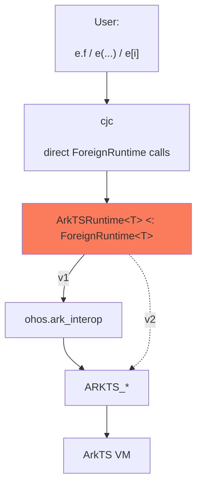
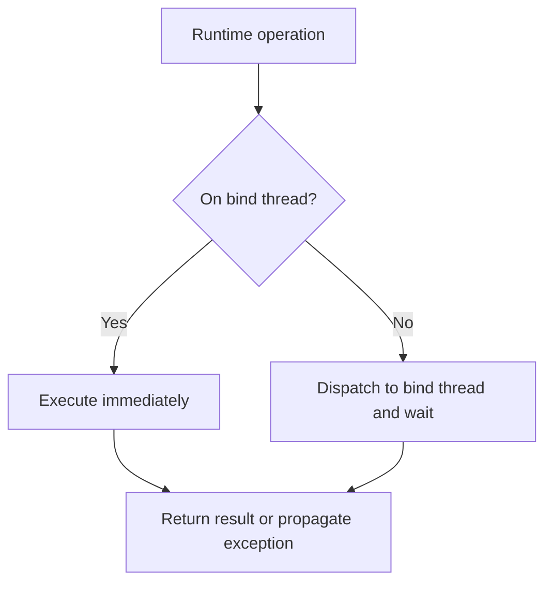

# ArkTS foreign runtime

This document specifies a generic `ArkTSRuntime<T>` foreign-runtime abstraction for accessing
ArkTS/JS values from Cangjie.

**Background.** As specified in [the simple extern model](extern_architecture_simple_model.md),
`Extern<T>` represents a value in a *foreign memory space*. It is a struct holding an opaque
`Any` payload, accessible through `Extern<T>.getPayload`. The compiler lowers dynamic
syntax to direct static calls on `T`. The type parameter `T` implements `ForeignRuntime<T>`.

Version 1 uses `ohos.ark_interop` as its backend. A later version will replace that backend
with direct Cangjie FFI bindings to OpenHarmony's native `ARKTS_*` interface.

## 1. Layering

User-facing dynamic syntax on `Extern<T>` never calls the VM directly. The compiler calls
the corresponding `ForeignRuntime<T>` method for each operation. `ArkTSRuntime<T>` dispatches
each operation to the JS thread and stores foreign values in the `Extern<T>` payload.
This version goes through `ohos.ark_interop`; later versions
will call the `ARKTS_*` FFI functions directly.

The orange box highlights `ArkTSRuntime<T>`, the focus of this document.



Consider the following example.

```cangjie
ArkTS.bind(context)

// ...

let api: Extern<ArkTS> = ArkTS.requireArkModule("test.ets")
let blob = api.createRectangle()
blob.width = 3.0
blob.width += 2.0
let a: Float64 = (Float64)blob.area()
```

The compiler lowers the dynamic operations as follows:

```cangjie
ArkTS.bind(context)

// ...

let blob = ArkTS.functionCall(ArkTS.memberAccess(api, "createRectangle"), [])

ArkTS.memberUpdate(blob, "width", 3.0)

let $tmp1 = blob
let $tmp2 = ArkTS.memberAccess(ArkTS.memberAccess($tmp1, "width"), "+")
ArkTS.memberUpdate($tmp1, "width", ArkTS.functionCall($tmp2, [2.0]))

let a: Float64 = ArkTS.fromExtern<Float64>(
                    ArkTS.functionCall(ArkTS.memberAccess(blob, "area"), [])
                 )
```

`ArkTSRuntime<T>` must implement the functions called in the desugared code above, along with the other APIs listed below.

## 2. `ArkTSRuntime<T>` interface

`ArkTSRuntime<T>` is an abstract base class implementing `ForeignRuntime<T>`. Its public surface
is summarized below; the following sections describe its behavior.

```cangjie
class ArkTSRuntimeCannotCallInAbstract <: Exception {}

abstract public class ArkTSRuntime<T> <: ForeignRuntime<T> where T <: ArkTSRuntime<T> {
    // Context
    public static func bind(newContext: JSContext): Unit {
        throw ArkTSRuntimeCannotCallInAbstract("Cannot call bind from abstract ArkTSRuntime")
    }
    protected static func getContext(): JSContext {
        throw ArkTSRuntimeCannotCallInAbstract("Cannot call getContext from abstract ArkTSRuntime")
    }

    // Dynamic operations
    public static func memberAccess(e: Extern<T>, field: String): Extern<T> { ... }
    public static func indexedAccess(e: Extern<T>, arg: Any): Extern<T> { ... }
    public static func memberUpdate(e: Extern<T>, field: String, value: Any): Unit { ... }
    public static func indexedUpdate(e: Extern<T>, field: Any, value: Any): Unit { ... }
    public static func functionCall(e: Extern<T>, args: Array<Any>): Extern<T> { ... }

    // Conversions
    public static func fromExtern<R>(value: Extern<T>): R { ... }
    public static func toExtern<R>(value: R): Extern<T> { ... }

    // Common values
    public static func undefined(): Extern<T> { ... }
    public static func null(): Extern<T> { ... }
    public static func object(): Extern<T> { ... }
    public static func global(): Extern<T> { ... }
    public static func symbol(description!: String = ""): Extern<T> { ... }

    // Value checks
    public static func strictEqual(lhs: Extern<T>, rhs: Extern<T>): Bool { ... }
    public static func isNull(value: Extern<T>): Bool { ... }
    public static func isUndefined(value: Extern<T>): Bool { ... }

    // Own properties
    public static func objectHasProperty(value: Extern<T>, key: String): Bool { ... }
    public static func objectKeys(value: Extern<T>): Array<String> { ... }
    public static func objectDefineOwnProperty(
        value: Extern<T>,
        key: String,
        propertyValue: Any,
        isWritable!: Bool = true,
        isEnumerable!: Bool = true,
        isConfigurable!: Bool = true
    ): Bool { ... }

    // Modules
    public static func requireArkModule(specifier: String): Extern<T> { ... }
    public static func requireSystemNativeModule(
        moduleName: String,
        prefix: ?String
    ): Extern<T> { ... }
}
```

The five dynamic-operation methods, `fromExtern`, and `toExtern` form the compiler-facing
`ForeignRuntime<T>` contract. The remaining methods are ArkTS-specific entry points used
directly by applications and generated bindings.


## 3. Multiple runtime instances

We use the `@ArkTSInstance` macro to declare multiple ArkTS runtime instances, each represented
by a distinct type. The macro generates a subclass that passes its own type as `T` to
`ArkTSRuntime<T>`. Each subclass inherits the shared runtime operations and owns an independent
context binding. For example, `@ArkTSInstance(ArkTSExample)` expands to the following class
(method bodies omitted):

```cangjie
class ArkTSExample <: ArkTSRuntime<ArkTSExample> {
    private static var context: ?JSContext = None

    protected static func getContext(): JSContext {...}
    public static func bind(newContext: JSContext): Unit {...}
}
```

`JSContext` identifies one ArkTS/JS engine instance. Each generated runtime can be bound to
exactly one context:

```cangjie
@ArkTSInstance(ArkTS1)
@ArkTSInstance(ArkTS2)

ArkTS1.bind(context1)
ArkTS2.bind(context2)

let first: Extern<ArkTS1> = ArkTS1.global()
let second: Extern<ArkTS2> = ArkTS2.global()
```

`Extern<ArkTS1>` and `Extern<ArkTS2>` are different types whose operations use their respective
contexts. Values from one runtime cannot be used directly in another; transferring supported
data requires conversion through Cangjie values.

The first successful `bind` permanently installs the context. Later calls throw an
exception, even for the same context. Using an unbound runtime also throws an exception.

There is no `unbind` or context replacement. A different context requires a different
specialization. Exactly one concurrent `bind` can succeed; callers must wait for it to
complete before using the runtime.

## 4. Thread dispatch

Internal dispatcher:

```cangjie
private static func run<R>(operation: () -> R): R
```

Engine calls execute on the context's bind thread (the JS thread). Runtime operations
are synchronous to the caller: calls from the bind thread execute directly; calls from
other threads wait for execution on the bind thread. Results and exceptions return to
the calling thread.

An expression containing multiple dynamic operations dispatches each operation separately.



**Possible optimization.** If all callers are guaranteed to use the bind thread,
the runtime could omit the thread check and dispatch.

## 5. Handle model

For `ArkTSRuntime<T>`, the opaque payload of `Extern<T>` is a runtime-owned handle that
stores a backend-specific representation of a foreign value from the context bound to `T`.
The handle maintains any retained references needed to keep that value alive. The same
lifetime guarantees apply to both versions of the library, regardless of the representation.

The runtime manages this lifetime automatically. Users can store `Extern<T>` values in
variables, fields, or collections, return them from functions, and reuse them across calls
without manually retaining or releasing the underlying values. A referenced ArkTS value
remains alive while its handle is reachable from Cangjie. Copying an `Extern<T>` preserves
access to the same foreign value, without duplicating the ArkTS object.

For example, the returned handle keeps an object alive after the function that created it
returns. These examples assume `ArkTS` has already been bound to a context.

```cangjie
func createObject(): Extern<ArkTS> {
    let value: Extern<ArkTS> = ArkTS.object()
    value.label = "original"
    return value // The object remains usable after this function returns.
}

func useObject(): Unit {
    let original: Extern<ArkTS> = createObject()
    let copy: Extern<ArkTS> = original // Both handles refer to the same ArkTS object.

    copy.label = "updated"
    println((String)original.label) // Prints "updated".
}

useObject() // No manual retain or release is needed.
```

For callable properties, the handle retains both the function value and its receiver.
An extracted method therefore keeps its receiver alive for later calls, even if the original
Cangjie variable holding that receiver is no longer in use.

Using the module from the earlier rectangle example:

```cangjie
func extractArea(): Extern<ArkTS> {
    let api: Extern<ArkTS> = ArkTS.requireArkModule("test.ets")
    let rectangle: Extern<ArkTS> = api.createRectangle()
    return rectangle.area // Retains both the function and rectangle.
}

let area: Extern<ArkTS> = extractArea()
let result: Float64 = (Float64)area() // The saved rectangle is still the receiver.
```

The local `rectangle` variable is out of scope when `area()` runs, but the extracted method
keeps the underlying object alive. The user does not need to store the receiver separately.

When a handle is no longer needed, the runtime automatically releases its retained references
on the context's bind thread. This allows the ArkTS garbage collector to reclaim values that
have no other references; it does not require immediate destruction of the underlying objects.
For example, after `useObject()` returns, its local handles no longer keep the object alive.

## 6. Dynamic operations

The compiler lowers each dynamic operation to a direct static call:

```cangjie
e.f                   → T.memberAccess(e, "f")
e[i]                  → T.indexedAccess(e, i)
e.f = v               → T.memberUpdate(e, "f", v)
e[i] = v              → T.indexedUpdate(e, i, v)
e(a, b)               → T.functionCall(e, [a, b])

a.b.c                 → T.memberAccess(T.memberAccess(a, "b"), "c")
a.m(10)               → T.functionCall(T.memberAccess(a, "m"), [10])

a.b(42).c = d.e().f() → T.memberUpdate(
    T.functionCall(T.memberAccess(a, "b"), [42]),
    "c",
    T.functionCall(
        T.memberAccess(T.functionCall(T.memberAccess(d, "e"), []), "f"),
        []
    )
)
```

Arguments, indices, and update values retain their Cangjie types and are passed through
`Any`; dynamic subexpressions are evaluated before the receiving method is called.
Reads and calls return `Extern<T>` values; updates return `Unit`.

### Execution through `run`

All five dynamic-operation methods use the internal `run` dispatcher described in
[Thread dispatch](#4-thread-dispatch). It ensures that engine operations execute on the
bind thread of `T`'s context. If the caller is already on that thread, the operation runs
directly; otherwise, the caller waits while `run` dispatches it to the bind thread.
The result or exception is returned to the caller, so users do not need to dispatch
dynamic operations themselves.

All work that accesses the engine takes place inside the callback passed to `run`. This
includes converting property keys, indices, arguments, and assigned values to their foreign
representations, performing the operation, and retaining any returned foreign value in an
`Extern<T>` handle. That handle remains valid after `run` returns, as described in the
handle model.

Schematic implementations, with backend-specific steps omitted:

```cangjie
public static func memberAccess(e: Extern<T>, field: String): Extern<T> {
    run<Extern<T>> {
        // Read the property and return a retained Extern<T> handle.
        ...
    }
}

public static func memberUpdate(e: Extern<T>, field: String, value: Any): Unit {
    run<Unit> {
        // Convert the assigned value and update the property.
        ...
    }
}
```

`indexedAccess`, `indexedUpdate`, and `functionCall` follow the same pattern. Each method
dispatches independently: in `a.m(10)`, the `memberAccess` call completes before
`functionCall` starts its own `run` call. A chain such as `a.b.c` likewise performs one
dispatch per member access; the complete expression is not a single operation on the JS thread.

### Member access

```cangjie
public static func memberAccess(e: Extern<T>, field: String): Extern<T>
public static func memberUpdate(e: Extern<T>, field: String, value: Any): Unit
```

Within `run`, `memberAccess` reads the named property and wraps its value in an `Extern<T>`
handle. `memberUpdate` converts the supplied value and writes it to that property.

For supported operator names, `memberAccess` returns a callable that applies the
operator to the receiver and its argument.

### Indexed access

```cangjie
public static func indexedAccess(e: Extern<T>, arg: Any): Extern<T>
public static func indexedUpdate(e: Extern<T>, field: Any, value: Any): Unit
```

Indices may be `Int64` positions, `String` property names, or `Extern<T>`
values from the same runtime representing strings, symbols, or numbers. Unsupported
index types throw `ExternIndexedAccessException`.

Within `run`, these methods resolve the index and read or update the corresponding element
or property. Reads retain the returned value; updates convert the assigned value before writing.

### Calls and receivers

```cangjie
public static func functionCall(e: Extern<T>, args: Array<Any>): Extern<T>
```

Within `run`, `functionCall` converts the arguments, invokes the function with its receiver,
and wraps the returned value in a retained `Extern<T>` handle.

`functionCall` receives only a callee value and its arguments, so it cannot distinguish
a member call from a call through an extracted function. Callable properties returned by
`memberAccess` and `indexedAccess` retain their receiver. Extracted methods therefore
keep their receiver, following Cangjie method semantics, unlike bare JS. Functions obtained
without a receiver receive `undefined` as `this`.

```cangjie
a.m(10)           // this = a

let x = a.m
x(20)             // this = a
```

Passing a callable property back to ArkTS passes the original function. The saved
receiver applies only to Cangjie dynamic calls. Calling a non-callable value throws
`ExternFunctionAccessException`.

## 7. Conversions

A Cangjie value used where `Extern<T>` is expected becomes a call to `T.toExtern`.
This applies, for example, to variable initialization, assignment, function arguments,
and return values whose expected type is `Extern<T>`. Conversion in the other direction
is explicit: a forced cast `(U)e` becomes `T.fromExtern<U>(e)`.

The runtime type `T` selects the context in which the foreign value is created or read.
The examples below assume that each runtime used has already been bound to its context.

### Execution and lifetime

Both conversion methods use `run` for any work that accesses the engine. Creating foreign
values, reading them, and converting array elements therefore happen on the context's bind
thread. The caller receives the converted result, or an exception, after the operation
completes. The Cangjie expression supplied as input is evaluated before the conversion call.

`toExtern` returns a retained handle with the lifetime guarantees described in section 5.
`fromExtern` produces a Cangjie value without consuming or invalidating the source handle.
Returning an existing `Extern<T>` unchanged requires no new foreign allocation.

### Type mapping

For each supported `U`, `V` denotes its mapped ArkTS type. The Cangjie source type selects
the mapping for `toExtern`; the requested Cangjie result type selects it for `fromExtern`.

| Cangjie type | ArkTS type |
| --- | --- |
| `Unit` | `undefined` |
| `Bool` | `boolean` |
| `Int8` | `number` |
| `Int16` | `number` |
| `Int32` | `number` |
| `Int64` | `bigint` |
| `UInt8` | `number` |
| `UInt16` | `number` |
| `UInt32` | `number` |
| `UInt64` | `bigint` |
| `Float16` | `number` |
| `Float32` | `number` |
| `Float64` | `number` |
| `BigInt` | `bigint` |
| `String` | `string` |
| `Option<U>` | `V \| undefined` |
| `Array<U>` | `Array<V>` |

### Conversion rules

Dynamic-call arguments and values assigned to foreign properties follow the same type
mapping as `toExtern`. They reach the runtime as `Any`; the compiler does not insert a
separate `toExtern` call for them. The receiving operation performs the conversion inside
its own `run` callback. For example, `object.label = "name"` passes the Cangjie string to
`memberUpdate`, which converts it before updating the foreign property.

An `Extern<T>` from the same runtime supplies its foreign value without copying it.
Values from other runtime specializations are not accepted.

### `toExtern`: Cangjie value → `Extern<T>`

```cangjie
public static func toExtern<R>(value: R): Extern<T>
```

`toExtern` converts a supported Cangjie value according to the table above. An existing
`Extern<T>` is returned unchanged, preserving any saved receiver.

The implicit and explicit forms use the same conversion:

```cangjie
let width: Float64 = 3.0
let foreignWidth: Extern<ArkTS> = width // Calls ArkTS.toExtern<Float64>(width).
let explicitWidth: Extern<ArkTS> = ArkTS.toExtern<Float64>(width)

let sameHandle: Extern<ArkTS> = ArkTS.toExtern<Extern<ArkTS>>(foreignWidth)
```

Both `foreignWidth` and `explicitWidth` represent the ArkTS number `3.0`. `sameHandle`
preserves the handle supplied as input.

### `fromExtern`: `Extern<T>` → Cangjie type `R`

```cangjie
public static func fromExtern<R>(value: Extern<T>): R
```

`fromExtern<R>` converts the foreign value to the requested Cangjie type. Converting to
`Unit` discards the value. Conversion to the same `Extern<T>` returns it unchanged,
including any saved receiver.

```cangjie
let restoredWidth: Float64 = (Float64)foreignWidth
let restoredDirectly: Float64 = ArkTS.fromExtern<Float64>(foreignWidth)
```

The cast and direct call perform the same conversion. An expected Cangjie type alone does
not insert `fromExtern`: `let width: Float64 = foreignWidth` requires an explicit cast.

### Options and arrays

`Option<U>` converts `Some(value)` using the mapping for `U` and `None` to `undefined`.
In the reverse direction, `undefined` becomes `None`; other values are converted to `U`
and wrapped in `Some` if that conversion succeeds.

```cangjie
let title: Option<String> = Some("rectangle")
let foreignTitle: Extern<ArkTS> = title // ArkTS string "rectangle".

let missing: Option<String> = None
let foreignMissing: Extern<ArkTS> = missing // ArkTS undefined.
let restoredMissing: Option<String> = (Option<String>)foreignMissing // None.
```

Arrays convert each element using its type's mapping. Conversion creates an array in the
destination runtime; subsequent changes to either array's elements are not automatically
reflected in the other array. Elements that are themselves `Extern<T>` handles continue
to refer to their foreign values.

```cangjie
let labels: Array<String> = ["width", "height"]
let foreignLabels: Extern<ArkTS> = labels
let restoredLabels: Array<String> = (Array<String>)foreignLabels

foreignLabels[0] = "depth"
println(labels[0])         // Prints "width".
println(restoredLabels[0]) // Prints "width".
```

### Conversion failures and runtime boundaries

Unsupported or failed conversions throw `ExternConversionException`, including failures
while converting an option's value or an array element. The generic signatures do not imply
that every Cangjie type is supported; the runtime checks whether it can perform the requested
conversion.

A value from another runtime specialization is also rejected. To transfer supported data,
convert it to a Cangjie value with the source runtime, then convert that value with the
destination runtime:

```cangjie
let source: Extern<ArkTS1> = "hello"
let text: String = (String)source
let destination: Extern<ArkTS2> = text
```

Here the source and destination handles belong to their respective contexts. Assigning
`source` directly to an `Extern<ArkTS2>` would invoke `ArkTS2.toExtern` and fail; it would
not move the foreign value between contexts. Direct conversion between runtime specializations
could be supported in a future version.

## 8. Helpers

These ArkTS APIs complement the compiler-facing `ForeignRuntime` methods. They follow
the same threading and value-lifetime rules: each helper uses `run` for engine access on
the context's bind thread, and any returned `Extern<T>` retains its foreign value. Results
and exceptions return synchronously to the caller. These guarantees apply to both backends.

Helpers that accept foreign values operate on values from the same runtime specialization.
The examples below assume `ArkTS` has already been bound to a context.

### Common values

```cangjie
public static func undefined(): Extern<T>
public static func null(): Extern<T>
public static func object(): Extern<T>
public static func global(): Extern<T>
public static func symbol(description!: String = ""): Extern<T>
```

| API | Behavior |
| --- | --- |
| `undefined()` | Return the ArkTS `undefined` value. |
| `null()` | Return the ArkTS `null` value. |
| `object()` | Create a new empty ArkTS object. |
| `global()` | Return the global object of the bound context. |
| `symbol(description: ...)` | Create a new symbol with an optional description. |

`object()` creates a distinct object on each call, while `global()` refers to the existing
global object. Each call to `symbol` creates a distinct symbol, even when descriptions match.
Symbols can be used as property keys through dynamic indexed access.

```cangjie
let missing: Extern<ArkTS> = ArkTS.undefined()
let empty: Extern<ArkTS> = ArkTS.null()
let record: Extern<ArkTS> = ArkTS.object()
let globals: Extern<ArkTS> = ArkTS.global()
let key: Extern<ArkTS> = ArkTS.symbol(description: "tag")

record.name = "rectangle"
record[key] = "metadata"
let tag: String = (String)record[key] // "metadata".
```

### Value checks

```cangjie
public static func strictEqual(lhs: Extern<T>, rhs: Extern<T>): Bool
public static func isNull(value: Extern<T>): Bool
public static func isUndefined(value: Extern<T>): Bool
```

`strictEqual` applies ArkTS/JS `===` to the underlying foreign values, without coercing
their types. For objects, it compares object identity. It does not compare the Cangjie
handles themselves. `isNull` and `isUndefined` test for their respective values; `null`
and `undefined` are distinct.

These helpers return Cangjie `Bool` values directly, so their results can be used in
conditions without a forced cast.

```cangjie
let sameObject: Bool = ArkTS.strictEqual(record, record) // true.
let differentObject: Bool = ArkTS.strictEqual(record, ArkTS.object()) // false.
let isMissing: Bool = ArkTS.isUndefined(missing) // true.
let isEmpty: Bool = ArkTS.isNull(empty) // true.
let sameValue: Bool = ArkTS.strictEqual(missing, empty) // false.
```

### Own properties

```cangjie
public static func objectHasProperty(value: Extern<T>, key: String): Bool
public static func objectKeys(value: Extern<T>): Array<String>
public static func objectDefineOwnProperty(
    value: Extern<T>,
    key: String,
    propertyValue: Any,
    isWritable!: Bool = true,
    isEnumerable!: Bool = true,
    isConfigurable!: Bool = true
): Bool
```

`objectHasProperty` checks whether the object itself has the named property, excluding
properties inherited from its prototype. A property whose value is `undefined` still
counts as present.

`objectKeys` returns a Cangjie array containing the object's own enumerable string keys.
Inherited properties, non-enumerable properties, and symbol keys are excluded. The returned
array is a snapshot; later property changes do not update it.

`objectDefineOwnProperty` defines an own data property. It converts `propertyValue` using
the rules in section 7 inside its `run` callback, and returns whether the definition
succeeded. Exceptions raised by the engine propagate to the caller. Its named flags all
default to `true`:

| Flag | Controls |
| --- | --- |
| `isWritable` | Whether the property's value can be changed by assignment. |
| `isEnumerable` | Whether the property appears in `objectKeys`. |
| `isConfigurable` | Whether deletion and reconfiguration of the property are allowed. |

For example, add a property that can be read but is not writable or enumerable:

```cangjie
let defined: Bool = ArkTS.objectDefineOwnProperty(
    record, "internalId", "shape-1",
    isWritable: false,
    isEnumerable: false,
    isConfigurable: false
)
let hasId: Bool = ArkTS.objectHasProperty(record, "internalId") // true.
let internalId: String = (String)record.internalId // "shape-1".
let keys: Array<String> = ArkTS.objectKeys(record) // ["name"].

record.optional = ArkTS.undefined()
let hasOptional: Bool = ArkTS.objectHasProperty(record, "optional") // true.
let optionalIsUndefined: Bool = ArkTS.isUndefined(record.optional) // true.
```

The symbol key created earlier and `internalId` are absent from `keys`. Adding `optional`
afterward does not change the already returned array.

### Module loading

```cangjie
public static func requireArkModule(specifier: String): Extern<T>
public static func requireSystemNativeModule(
    moduleName: String,
    prefix: ?String
): Extern<T>
```

`requireArkModule` loads an ArkTS module using a specifier understood by the host environment.
`requireSystemNativeModule` loads a registered system native module. Its `prefix` argument
must be supplied explicitly: use `None` for the default lookup or `Some(prefix)` when the
module requires a lookup prefix.

Both helpers perform loading through `run` and wrap the loader's result in an `Extern<T>`
handle. The result is typically an object whose exports can be accessed through dynamic
operations. It belongs to the context of `T` and follows the normal handle-lifetime rules.

```cangjie
let api: Extern<ArkTS> = ArkTS.requireArkModule("test.ets")
let rectangle: Extern<ArkTS> = api.createRectangle()

let logging: Extern<ArkTS> = ArkTS.requireSystemNativeModule("hilog", None)
let loggingUnavailable: Bool = ArkTS.isUndefined(logging)
```

Module availability and resolution depend on the host environment. Loading exceptions
propagate to the caller; if the loader reports failure by returning `undefined`, the helper
preserves that result, which can be checked with `isUndefined`.

## 9. Optimizations

The runtime can reduce conversion, allocation, and dispatch costs within each static call
without changing the `ForeignRuntime<T>` interface. The ideas in the
[Extern design's runtime optimizations](extern_architecture_simple_model.md#5-runtime-implementer-possible-optimizations)
apply here: interning property keys, caching converted strings, and converting aggregates
in bulk. The available backend operations determine which optimizations can be implemented.

All optimizations must preserve the type mappings, evaluation order, exceptions, receiver
binding, and value-lifetime guarantees described above. The examples below assume `ArkTS`
has already been bound to a context.

### Name resolution caching

Repeated member access should cache only the conversion of a Cangjie field name to an
ArkTS property key. This is property-key interning: after a cache miss creates and retains
the key, later operations reuse it. Member reads and updates, string-based indexed access,
and property helpers can share the same cache within a runtime specialization.

Thus the first access to `a.foo` creates the ArkTS string for `"foo"`; later accesses
reuse it and avoid another string conversion. The resolved value of `a.foo` is never
cached: every access still performs normal ArkTS property lookup, preserving reassignment,
getters, proxy traps, and exceptions.

For example, all operations below reuse the key `"price"`, but the two reads observe
different values:

```cangjie
let record: Extern<ArkTS> = ArkTS.object()
record.price = 3.0
let firstPrice: Float64 = (Float64)record.price // 3.0.

record.price = 4.0
let secondPrice: Float64 = (Float64)record.price // 4.0.
```

The same rule applies to method access: cache the property key, but look up the function on each access.

### Caching converted strings

Strings are immutable, so conversions may cache the association between a Cangjie `String`
and its retained foreign representation. Repeated `toExtern<String>` calls can reuse the
foreign string, while repeated `fromExtern<String>` calls can reuse an already converted
Cangjie string. The same conversion cache can serve strings passed as dynamic-call
arguments or assigned to foreign properties.

```cangjie
let firstTag: Extern<ArkTS> = "network"
let secondTag: Extern<ArkTS> = "network" // May reuse the converted foreign string.

let firstText: String = (String)firstTag
let secondText: String = (String)secondTag // May reuse the converted Cangjie string.
```

This reuse applies to string contents, not to the results of arbitrary operations involving
strings. For example, caching `"network"` in `logger.tag("network")` does not remove the call
to `tag`. Fresh objects and symbols must also retain their identity semantics: `object()`
and `symbol(description: "network")` still create distinct values on each call.