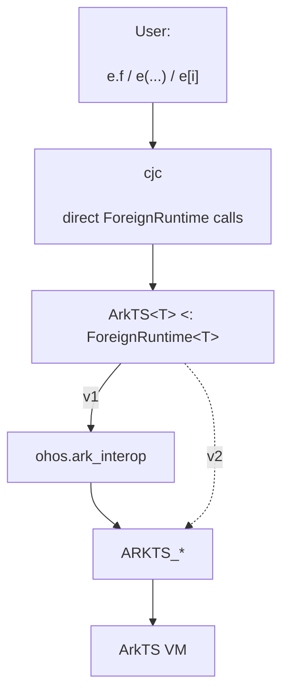
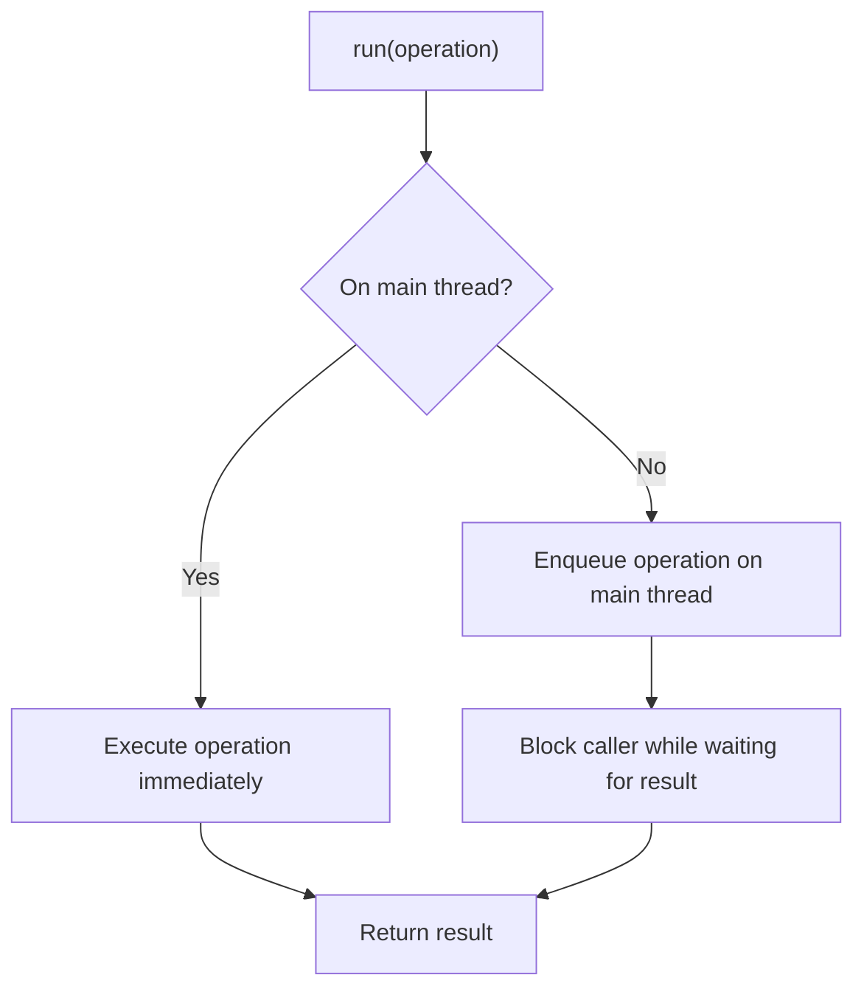
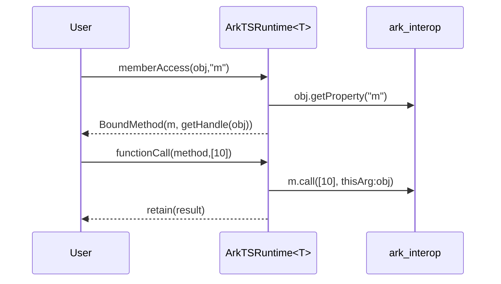

# ArkTS foreign runtime

This document specifies a generic `ArkTSRuntime<T>` foreign-runtime abstraction for accessing
ArkTS/JS values from Cangjie.

**Background.** As specified in [the simple extern model](extern_architecture_simple_model.md),
`Extern<T>` represents a value in a *foreign memory space*. It is a struct holding an opaque
`Any` payload, accessible through `Extern<T>.getPayload`. The compiler lowers dynamic
syntax to direct static calls on `T`. The type parameter `T` implements `ForeignRuntime<T>`;
`ArkTS<T>` supplies the ArkTS implementation for concrete, self-typed runtime classes.

Version 1 uses `ohos.ark_interop` as its backend. A later version will replace that backend
with direct Cangjie FFI bindings to OpenHarmony's native `ARKTS_*` interface.

## 1. Layering

User-facing dynamic syntax on `Extern<T>` never calls the VM directly. The compiler calls
the corresponding `ForeignRuntime<T>` method for each operation. `ArkTS<T>` performs each
operation through the thread-safe `run` wrapper and stores values as an internal
`ArkTSHandle` inside the `Extern<T>` payload. This version goes through `ohos.ark_interop`; later versions
will call the `ARKTS_*` FFI functions directly.



```cangjie
ArkTS.bind(context)                  // bind this runtime instance at entry

// ...

let api: Extern<ArkTS> = ArkTS.requireArkModule("test.ets")
let blob = api.createRectangle()
blob.width = 3.0
blob.width += 2.0
let a: Float64 = (Float64)blob.area()
```

The compiler lowers the dynamic operations as follows:

```cangjie
ArkTS.bind(context)                  // bind this runtime instance at entry

// ...

let blob = ArkTS.functionCall(ArkTS.memberAccess(api, "createRectangle"), [])

ArkTS.memberUpdate(blob, "width", 3.0)

let $tmp1 = blob
let $tmp2 = ArkTS.memberAccess(ArkTS.memberAccess($tmp1, "width"), "+")
ArkTS.memberUpdate($tmp1, "width", ArkTS.functionCall($tmp2, [2.0]))

let a: Float64 = ArkTS.fromExtern<Float64>(
                    ArkTS.functionCall(ArkTS.memberAccess(blob, "area"), [])
                 )
```

The assigned `3.0` and compound right operand `2.0` are passed as `Any` operands
and are converted by the ArkTS runtime when it performs each operation.

## 2. `ArkTSRuntime<T>` interface

`ArkTSRuntime<T>` is an abstract base class implementing `ForeignRuntime<T>`. Its public surface
is summarized below; method bodies are omitted, and the following sections describe the
semantics and implementation details.

```cangjie
abstract public class ArkTSRuntime<T> <: ForeignRuntime<T> where T <: ArkTSRuntime<T> {
    // Associate this runtime specialization with one JS context.
    public static func bind(newContext: JSContext): Unit

    // Perform dynamic operations.
    public static func memberAccess(e: Extern<T>, field: String): Extern<T>
    public static func indexedAccess(e: Extern<T>, arg: Any): Extern<T>
    public static func memberUpdate(e: Extern<T>, field: String, value: Any): Unit
    public static func indexedUpdate(e: Extern<T>, field: Any, value: Any): Unit
    public static func functionCall(e: Extern<T>, args: Array<Any>): Extern<T>

    // Convert between Cangjie and ArkTS values.
    public static func fromExtern<R>(value: Extern<T>): R
    public static func toExtern<R>(value: R): Extern<T>

    // Create or obtain common ArkTS values.
    public static func undefined(): Extern<T>
    public static func null(): Extern<T>
    public static func object(): Extern<T>
    public static func global(): Extern<T>
    public static func symbol(description!: String = ""): Extern<T>

    // Compare or classify ArkTS values.
    public static func strictEqual(lhs: Extern<T>, rhs: Extern<T>): Bool
    public static func isNull(value: Extern<T>): Bool
    public static func isUndefined(value: Extern<T>): Bool

    // Inspect or define an object's own properties.
    public static func objectHasProperty(value: Extern<T>, key: String): Bool
    public static func objectKeys(value: Extern<T>): Array<String>
    public static func objectDefineOwnProperty(
        value: Extern<T>,
        key: String,
        propertyValue: Any,
        isWritable!: Bool = true,
        isEnumerable!: Bool = true,
        isConfigurable!: Bool = true
    ): Bool

    // Load ArkTS or system-native modules.
    public static func requireArkModule(specifier: String): Extern<T>
    public static func requireSystemNativeModule(
        moduleName: String,
        prefix: ?String
    ): Extern<T>
}
```

The five dynamic-operation methods, `fromExtern`, and `toExtern` form the compiler-facing
`ForeignRuntime<T>` contract. The remaining methods are ArkTS-specific entry points used
directly by applications and generated bindings.


Concrete runtime specializations subclass `ArkTSRuntime<T>`:

```cangjie
class ArkTS1 <: ArkTSRuntime<ArkTS1> {}
class ArkTS2 <: ArkTSRuntime<ArkTS2> {}
```

## 3. Context

`ArkTSRuntime<T>` is an abstract generic base class whose type parameter identifies a concrete
ArkTSRuntime runtime.

`JSContext` is the `ark_interop` handle to one ArkTS/JS engine instance. Each concrete
specialization can be bound to exactly one context. This permits multiple ArkTS foreign
runtimes, such as `ArkTS1 <: ArkTSRuntime<ArkTS1>` and `ArkTS2 <: ArkTSRuntime<ArkTS2>`, without mixing
their values: `Extern<ArkTS1>` and `Extern<ArkTS2>` are different types. The first
successful call to `bind` permanently installs the context for that specialization. Every
later call throws `ArkTSContextAlreadyBoundException`, even if it supplies the same
`JSContext`. The dynamic operations and helpers read the installed context through the private
`context` property, which throws if the runtime was never bound.

```cangjie
public class ArkTSContextNotBoundException <: Exception {}
public class ArkTSContextAlreadyBoundException <: Exception {}

abstract public class ArkTSRuntime<T> <: ForeignRuntime<T> where T <: ArkTSRuntime<T> {
    private static let contextMutex = Mutex()
    private static var context_: ?JSContext = None

    public static func bind(newContext: JSContext): Unit {
        synchronized(contextMutex) {
            match (context_) {
                case None => context_ = Some(newContext)
                case Some(_) => throw ArkTSContextAlreadyBoundException(
                    "ArkTS runtime is already associated with a host JSContext")
            }
        }
    }

    private static prop context: JSContext {
        get() {
            match (context_) {
                case Some(context) => context
                case None => throw ArkTSContextNotBoundException(
                    "ArkTS runtime is not associated with a host JSContext")
            }
        }
    }

    // ...

}
```

Each specialization can then be bound to its own context:

```cangjie
ArkTS1.bind(context1)
ArkTS2.bind(context2)

ArkTS1.bind(context1) // throws ArkTSContextAlreadyBoundException
```

There is deliberately no `unbind` or context-replacement operation. Code that needs a
different `JSContext` must define and bind a different concrete specialization. This keeps
every `ArkTSHandle` associated with the same engine for its entire lifetime. The mutex
makes the initial check-and-install atomic, ensuring that exactly one concurrent call to
`bind` can succeed. A context lookup that races with the successful initial bind may still
observe `None` and throw `ArkTSContextNotBoundException`; a caller that requires the bind
to be visible must wait until `bind` has completed before using the runtime.

## 4. Thread dispatch

ArkTS FFI is *bind-thread-affine*: engine calls are valid only on the thread that bound the
context (the JS thread). Each dynamic operation and public helper therefore runs its engine work
inside `run`, which looks synchronous to the caller regardless of which Cangjie thread
called it. A compound expression invokes `run` separately for each operation.

If `run` is called on the bind thread, it executes the operation directly, otherwise it posts the operation to the JS thread and blocks the caller until the
result is available.



```cangjie
private static func run<R>(operation: () -> R): R {
    if (context.isInBindThread()) {
        // (a) already on JS thread: run immediately
        return context.newScope {
            operation()
        }
    }

    // (b) other thread: hand the work to the JS thread and block for its result
    let result = Box(None<ArkTSResult<R>>)
    let mutex = Mutex()
    let done: Condition
    synchronized(mutex) {
        done = mutex.condition()
    }

    context.postJSTask {
        let completed: ArkTSResult<R> =
            try {
                let res = context.newScope {
                    operation()
                }
                ArkTSResult.Ok(res)
            } catch (e: Exception) {
                ArkTSResult.Err(e)
            }
        synchronized(mutex) {
            result.value = Some(completed)
            done.notify()
        }
    }

    synchronized(mutex) {
        done.waitUntil({ => result.value.isSome() })
        match (result.value.getOrThrow()) {
            case Ok(value) => value              // return the JS-thread value, or...
            case Err(error) => throw error       // ...rethrow the JS-thread exception here
        }
    }
}
```

Two cases:

- **(a) On the bind thread** — call `operation()` directly inside a short-lived scope.
- **(b) Off the bind thread** — post `operation` inside a short-lived scope with `postJSTask`, wait on a
  `Mutex`/`Condition`, then return its value or rethrow its exception. `ArkTSResult<R>` is
  the internal `Ok(R) | Err(Exception)` carrier used to move the outcome across threads.

**Possible optimization.** The runtime could expose a configuration option asserting that
all operations are invoked on the main thread. When enabled, `run` could execute the
operation directly, avoiding the thread check and dispatch overhead. This option would be
valid only when the context is bound to the main thread and the caller guarantees that all
operations originate there. A similar approach is followed by the current `ohos.ark_interop`
library.

## 5. Handle model

`Extern<T>` is the payload struct defined by the standard library:

```cangjie
public struct Extern<T> where T <: ForeignRuntime<T> {
    private var payload: Any = ()

    public Extern(payload: Any) {
        setExtern(this, payload)
    }
    public static func getPayload(e: Extern<T>): Any {
        getExtern(e)
    }
}
```

The core intrinsics `getExtern` and `setExtern` read and write the payload directly,
bypassing dynamic member-access/update desugaring. For `T <: ArkTSRuntime<T>`, the payload
is an `ArkTSHandle`:

```cangjie
private enum ArkTSHandle {
    | Imm(JSValue)      // undefined / null / boolean / number
    | Ref(JSHeapObject) // string / bigint / symbol / object / array / function / ...
    | BoundMethod(JSFunction, ArkTSHandle) // callable member + its retained receiver
}
```

| Variant | Holds | Why |
| --- | --- | --- |
| `Imm` | a `JSValue` | Immediates have no heap identity, so the value is stored as-is. |
| `Ref` | a `JSHeapObject` | Heap values are pinned as an engine-global so they survive across calls. |
| `BoundMethod` | a `JSFunction` and its receiver handle | A callable property remembers the receiver to use as `this` on a later call. |

`JSHeapObject` finalizers queue `ARKTS_DisposeGlobal` for execution on the context's bind
thread, so the finalizers themselves may run on any thread.

Two helpers read the payload and project its handle to a `JSValue` on the bind thread:

```cangjie
private static func getHandle(e: Extern<T>): ArkTSHandle {
    (Extern<T>.getPayload(e) as ArkTSHandle).getOrThrow()
}

private static func jsValue(handle: ArkTSHandle): JSValue {
    match (handle) {
        case Imm(value) => value
        case Ref(owner) => owner.toJSValue()
        case BoundMethod(function, _) => function.toJSValue()
    }
}
```

### Wrapping a JSValue as an Extern

`retain` is the single entry that turns a `JSValue` produced by the engine into an
`Extern`. It inspects the runtime type, promotes heap values to global handles,
and wraps the resulting `ArkTSHandle` in `Extern<T>`. An optional receiver is saved
when the value is a function.

```cangjie
private static func retain(value: JSValue, receiver!: ?ArkTSHandle = None): Extern<T> {
    if (value.isFunction()) {
        let function = value.asFunction()
        return match (receiver) {
            case Some(target) => Extern<T>(BoundMethod(function, target))
            case None => Extern<T>(Ref(function))
        }
    }
    if (value.isArray())   { return Extern<T>(Ref(value.asArray()))  }
    if (value.isSymbol())  { return Extern<T>(Ref(value.asSymbol())) }
    if (value.isString())  { return Extern<T>(Ref(value.asString())) }
    if (value.isBigInt())  { return Extern<T>(Ref(value.asBigInt())) }
    if (value.isObject())  { return Extern<T>(Ref(value.asObject())) }
    Extern<T>(Imm(value))     // undefined / null / boolean / number: engine immediates
}
```

Every heap value returned by a dynamic operation or helper must survive its `run` scope,
including intermediate results in a chain such as `a.b.c`. `retain` makes those values
global. This lets users keep `Extern` values without manually retaining them through
operations such as `value.asObject()`.

## 6. Dynamic operations

The compiler lowers each dynamic operation to a direct static call:

```cangjie
e.f                   → T.memberAccess(e, "f")
e[i]                  → T.indexedAccess(e, i)
e.f = v               → T.memberUpdate(e, "f", v)
e[i] = v              → T.indexedUpdate(e, i, v)
e(a, b)               → T.functionCall(e, [a, b])

a.b.c                 → T.memberAccess(T.memberAccess(a, "b"), "c")
a.m(10)               → T.functionCall(T.memberAccess(a, "m"), [10])

a.b(42).c = d.e().f() → T.memberUpdate(
    T.functionCall(T.memberAccess(a, "b"), [42]),
    "c",
    T.functionCall(
        T.memberAccess(T.functionCall(T.memberAccess(d, "e"), []), "f"),
        []
    )
)
```

Arguments, indices, and update values retain their Cangjie types and are passed through
`Any`; dynamic subexpressions are evaluated before the receiving method is called.
Each method enters `run` once. Reads and calls retain their result; updates return `Unit`.

```cangjie
public static func memberAccess(e: Extern<T>, field: String): Extern<T> {
    run {
        let handle = getHandle(e)
        let receiver = jsValue(handle)
        let value = if (isSupportedOperator(field)) {
            operatorFunction(field).toJSValue()
        } else {
            receiver.getProperty(field)
        }
        retain(value, receiver: Some(handle))
    }
}

public static func indexedAccess(e: Extern<T>, arg: Any): Extern<T> {
    run {
        let handle = getHandle(e)
        retain(readIndex(jsValue(handle), arg), receiver: Some(handle))
    }
}

public static func memberUpdate(e: Extern<T>, field: String, value: Any): Unit {
    run { jsValue(getHandle(e)).setProperty(field, toJSValue(value)) }
}

public static func indexedUpdate(e: Extern<T>, field: Any, value: Any): Unit {
    run { writeIndex(jsValue(getHandle(e)), field, value) }
}
```

For supported operator names, `operatorFunction` supplies a runtime-owned function
that preserves primitive `this` values and applies the operator to `this` and its argument,
for example `this + argument` for `"+"`. `isSupportedOperator` selects these names;
they are not ordinary JS properties.
Call arguments are already evaluated, including for `"&&"` and `"||"`.

### Indexed access

Index operations accept an integer position, a `String` property name, or an `Extern<T>`
from the same runtime. `toJSKeyable` projects its payload to a `JSValue`, and maps it onto
one of the `JSKeyable` types accepted by `getProperty` and `setProperty`: a string becomes
a `JSString`, a symbol a `JSSymbol`,
and a number a `Float64`. `writeIndex` resolves this key before converting the assigned
value. Operand expressions have already followed Cangjie evaluation order before the
runtime call.

```cangjie
private static func readIndex(target: JSValue, index: Any): JSValue {
    match (index) {
        case position: Int64 => target.getElement(position)
        case position: Int32 => target.getElement(Int64(position))
        case propertyName: String => target.getProperty(propertyName)
        case externalIndex: Extern<T> =>
            target.getProperty(toJSKeyable(externalIndex))
        case _ => throw ExternIndexedAccessException("Unsupported ArkTS index type")
    }
}

private static func writeIndex(target: JSValue, index: Any, value: Any): Unit {
    match (index) {
        case position: Int64 => target.setElement(position, toJSValue(value))
        case position: Int32 => target.setElement(Int64(position), toJSValue(value))
        case propertyName: String => target.setProperty(propertyName, toJSValue(value))
        case externalIndex: Extern<T> =>
            let key = toJSKeyable(externalIndex)
            target.setProperty(key, toJSValue(value))
        case _ => throw ExternIndexedAccessException("Unsupported ArkTS index type")
    }
}

private static func toJSKeyable(index: Extern<T>): JSKeyable {
    let value = jsValue(getHandle(index))
    if (value.isString()) { return value.asString() }  // JSString
    if (value.isSymbol()) { return value.asSymbol() }  // JSSymbol
    if (value.isNumber()) { return value.toNumber() }  // Float64
    throw ExternIndexedAccessException("Unsupported ArkTS index type")
}
```

### Calls and receivers

`functionCall` receives only a callee value and its arguments, so it cannot distinguish
a member call from a call through an extracted function. To preserve method calls,
`memberAccess` and `indexedAccess` return a `BoundMethod` for callable properties, retaining
both the function and the receiver. Extracted methods therefore keep their receiver,
unlike bare JS. Functions obtained without a receiver receive `undefined` as `this`.

```cangjie
a.m(10)           // functionCall(memberAccess(a, "m"), [10]): this = a

let x = a.m
x(20)             // functionCall(x, [20]): this = a
```

```cangjie
public static func functionCall(e: Extern<T>, args: Array<Any>): Extern<T> {
    run {
        let handle = getHandle(e)
        let value = jsValue(handle)
        if (!value.isFunction()) {
            throw ExternFunctionAccessException("ArkTS value is not callable")
        }
        let function = value.asFunction()
        let receiver = match (handle) {
            case BoundMethod(_, target) => jsValue(target)
            case _ => context.undefined().toJSValue()
        }
        let converted = Array<JSValue>(args.size) { index =>
            toJSValue(args[index])
        }
        retain(function.call(converted, thisArg: receiver))
    }
}
```

The saved receiver is metadata for Cangjie dynamic calls. Projecting a `BoundMethod`
through `jsValue` yields the original function, without creating a JS bound function.

Example flow for `obj.m(10)`:



## 7. Conversions

A Cangjie value used where
`Extern<T>` is expected becomes `T.toExtern`, while a forced cast `(U)e` becomes
`T.fromExtern<U>(e)`. This section covers those hooks and the internal `toJSValue` helper.

### Type mapping

For each supported `U`, `V` denotes its mapped ArkTS type.

| Cangjie type | ArkTS type |
| --- | --- |
| `Unit` | `undefined` |
| `Bool` | `boolean` |
| `Int8` | `number` |
| `Int16` | `number` |
| `Int32` | `number` |
| `Int64` | `bigint` |
| `UInt8` | `number` |
| `UInt16` | `number` |
| `UInt32` | `number` |
| `UInt64` | `bigint` |
| `Float16` | `number` |
| `Float32` | `number` |
| `Float64` | `number` |
| `BigInt` | `bigint` |
| `String` | `string` |
| `Option<U>` | `V \| undefined` |
| `Array<U>` | `Array<V>` |

### `toJSValue`: Cangjie value → `JSValue`

This bind-thread helper converts assigned values, call arguments, indexes, and values passed
to `toExtern`. An `Extern<T>` input is projected through `jsValue(getHandle(...))`.
Other values are converted according to their runtime type. The `Imm`/`Ref`
decision is deferred to `retain`.

```cangjie
private static func toJSValue(value: Any): JSValue {
    match (value) {
        case external: Extern<T> => jsValue(getHandle(external))
        case boolean: Bool    => context.boolean(boolean).toJSValue()
        case number: Int32    => context.number(number).toJSValue()
        case number: Float64  => context.number(number).toJSValue()
        case number: Int64    => context.bigint(number).toJSValue()
        case number: BigInt   => context.bigint(number).toJSValue()
        case text: String     => context.string(text).toJSValue()
        case items: Array<Int64>      => arrayJSValue(items)
        case items: Array<Float64>    => arrayJSValue(items)
        case items: Array<Bool>       => arrayJSValue(items)
        case items: Array<String>     => arrayJSValue(items)
        case items: Array<Extern<T>>  => arrayJSValue(items)
        ...
        case _ => throw ExternConversionException("Unsupported conversion to ArkTS")
    }
}
```

Notes:

- An `Extern<T>` from the same concrete runtime has its payload projected without a copy.
  An `Extern` belonging to another ArkTSRuntime specialization does not match this branch.
- `Int64` and `UInt64` become big ints.
- `Option<U>` maps `Some` through `toJSValue` and maps `None` to `undefined`.
- `arrayJSValue<E>` maps each supported array element through `toJSValue`.

### `toExtern`: Cangjie value → `Extern<T>`

The implicit-conversion `toExtern` calls `toJSValue` and `retain`s the value. An existing
`Extern<T>` is returned unchanged, preserving any saved receiver.

```cangjie
public static func toExtern<R>(value: R): Extern<T> {
    run {
        match (value) {
            case external: Extern<T> => external
            case _ => retain(toJSValue(value))
        }
    }
}
```

### `fromExtern`: `Extern<T>` → Cangjie type `R`

The forced-cast hook `(R)e` projects its argument's payload to a `JSValue`, then uses
the `ark_interop` reader for target type `R`.

```cangjie
public static func fromExtern<R>(e: Extern<T>): R {
    run {
        let value = jsValue(getHandle(e))
        match (None<R>) {    // dummy `None<R>` to match the type parameter
            case _: Option<Bool>    => (value.toBoolean() as R).getOrThrow()
            case _: Option<Int32>   => (Int32(value.toNumber()) as R).getOrThrow()   // read JS number, narrow to Int32
            case _: Option<Float64> => (value.toNumber() as R).getOrThrow()
            case _: Option<String>  => (value.toString() as R).getOrThrow()
            case _: Option<BigInt>  => (value.toBigInt() as R).getOrThrow()
            case _: Option<Unit> => (() as R).getOrThrow()
            case _: Option<Array<String>> =>
                let array = value.asArray()
                let converted = Array<String>(array.size) { index =>
                    array[index].toString()
                }
                (converted as R).getOrThrow()
            case _: Option<Extern<T>> => (e as R).getOrThrow()                      // identity: preserve receiver
            ...
            case _ => throw ExternConversionException(
                "Unsupported conversion from ArkTS")
        }
    }
}
```

Each target uses the corresponding `ark_interop` reader. Converting to `Unit` discards the
value; and conversion to the same `Extern<T>` is the identity case. Other target types are rejected.

## 8. Helpers

These ArkTS APIs are not part of the compiler-desugared `ForeignRuntime` surface. They
still use `run` for bind-thread safety and `retain` when returning a foreign value. Helpers
that consume an `Extern<T>` project its payload through `jsValue(getHandle(...))`.

| API | Role |
| --- | --- |
| `undefined()` / `null()` / `object()` / `symbol(...)` | Construct a JS value, then `retain` it. |
| `global()` | Return the context's global object through `retain`. |
| `strictEqual(a, b)` | Project both operands and apply JS `===`. |
| `isNull` / `isUndefined` | Project the operand and test the resulting `JSValue`. |
| `objectHasProperty` / `objectKeys` / `objectDefineOwnProperty` | Object metadata; `defineOwnProperty` converts its value with `toJSValue`. |
| `requireArkModule` | Load an Ark module, then `retain` the result. |
| `requireSystemNativeModule(moduleName, prefix)` | Load a system native module with an explicit optional prefix, then `retain` the result. |

```cangjie
public static func undefined(): Extern<T> { run { retain(context.undefined().toJSValue()) } }
public static func null(): Extern<T>      { run { retain(context.null().toJSValue()) } }
public static func object(): Extern<T>    { run { retain(context.object().toJSValue()) } }
public static func global(): Extern<T>    { run { retain(context.global.toJSValue()) } }
public static func symbol(description!: String = ""): Extern<T> {
    run { retain(context.symbol(description: description).toJSValue()) }
}

public static func strictEqual(lhs: Extern<T>, rhs: Extern<T>): Bool {
    run { jsValue(getHandle(lhs)).strictEqual(jsValue(getHandle(rhs))) }
}
public static func isNull(value: Extern<T>): Bool      { run { jsValue(getHandle(value)).isNull() } }
public static func isUndefined(value: Extern<T>): Bool { run { jsValue(getHandle(value)).isUndefined() } }

public static func requireSystemNativeModule(
    moduleName: String,
    prefix: ?String
): Extern<T> {
    run { retain(context.requireSystemNativeModule(moduleName, prefix: prefix)) }
}
```

## 9. Optimizations

Each operation completes before the next runtime call begins. The runtime therefore
cannot batch member chains, updates, or sequences, or send a whole expression to the
FFI through this interface. Such optimizations would require additional compiler/API
support. The caches below remain applicable.

### Name resolution caching

Repeated member access should cache only the conversion of a Cangjie field name to an
ArkTS property key. The cache belongs to the concrete `ArkTSRuntime<T>` specialization and is
used on the bind thread:

```cangjie
private static let propertyNames = HashMap<String, JSString>()

private static func propertyName(field: String): JSString {
    match (propertyNames.get(field)) {
        case Some(name) => name
        case None =>
            let name = context.string(field)
            propertyNames.add(field, name)
            name
    }
}

// Used by memberAccess and memberUpdate.
target.getProperty(propertyName(field))
```

Thus the first access to `a.foo` creates the ArkTS string for `"foo"`; later accesses
reuse it and avoid another string conversion. The resolved value of `a.foo` is never
cached: every access still performs normal ArkTS property lookup, preserving reassignment,
getters, proxy traps, and exceptions.

Examples that repeatedly use the same property key:

```cangjie
for (item in items) {
    total += (Float64)item.price
}

for (view in views) {
    view.render()
}
```

The ArkTS keys for `"price"` and `"render"` are created once and reused on every
iteration, even though each property lookup still happens normally.

### Caching immutable objects

Conversions may cache immutable values that have different Cangjie and ArkTS
representations. Strings are the primary case: the first conversion records both the
Cangjie `String` and a retained ArkTS string; later conversions in either direction reuse
that pair instead of copying the string again.

```cangjie
private static let strings = ImmutableCache<String, JSHeapObject>()

private static func stringToJS(text: String): JSValue {
    strings.foreignFor(text).getOrInsert({ => context.string(text) }).toJSValue()
}

private static func stringFromJS(value: JSValue): String {
    strings.cangjieFor(value).getOrInsert({ => value.toString() })
}

// Used by the String branches of toJSValue and fromExtern.
case text: String          => stringToJS(text)
case _: Option<String>     => (stringFromJS(value) as R).getOrThrow()
```

The cache is per concrete `ArkTSRuntime<T>` specialization because retained handles belong to
its bound context. It should be weak or bounded so cached globals do not live forever.
This is safe only for immutable values; mutable objects still require normal conversion
or an explicit invalidation policy.

Example with repeated conversion of the same immutable value:

```cangjie
for (event in events) {
    logger.tag("network").write(event) // reuse the ArkTS representation of "network"
}
```

