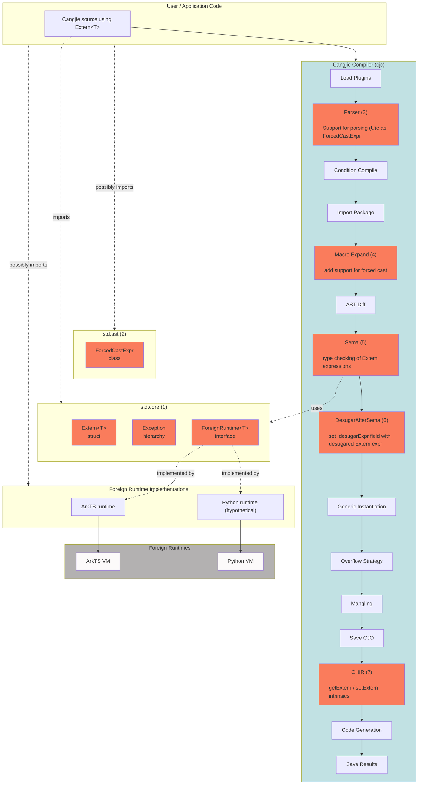

# Architecture/Feature Design Document: Cangjie `Extern<T>` Type

**Feature:** Language-level dynamic interoperability via `Extern<T>` and `ForeignRuntime<T>`

**Spec:** [The Cangjie Extern type](https://wiki.huawei.com/domains/4014/wiki/11230/WIKI2026040810696277)

---


## 1. Source and Value of Feature Requirements/Problems/Motivation

### Background

Existing interoperability mechanisms are language-specific, reflection-based, and require significant boilerplate. The `Extern<T>` feature addresses this by providing a lightweight, generic representation of foreign objects that enables direct interaction with external runtimes while keeping runtime-specific behavior encapsulated.

`Extern<T>` introduces a runtime-agnostic abstraction for references to values managed outside the Cangjie runtime. Rather than assuming a foreign object's type system or memory layout, Cangjie treats these values as opaque references and relies on the associated ForeignRuntime implementation to define conversion semantics and dynamic operations. This approach provides a lightweight alternative to wrapper-based interop while remaining extensible to multiple foreign runtimes.

The requirements for improved interop are captured in [Dynamic and gradual types for improved Cangjie–ArkTS interop](https://onebox.huawei.com/v/13b0bf0281118cb4b9ac3bd0366436eb?type=0) and the proposal document [The Cangjie Extern type](https://wiki.huawei.com/domains/4014/wiki/11230/WIKI2026040810696277). Together they motivate a language-level mechanism inspired by C# `dynamic`, but scoped explicitly to foreign runtimes rather than suspending all static typing.

### Before vs after (user perspective)

**Before** — reflection-based ArkTS interop:

```cangjie
func testCJ(runtime: JSContext, callInfo: JSCallInfo): Unit {
    let api = callInfo[0].asObject()
    let addF = api["add"].asFunction()
    let args = [runtime.number(2).toJSValue(), runtime.number(3.5).toJSValue()]
    let receiver = runtime.null().toJSValue()
    let result = addF.call(args, thisArg: receiver).asNumber().toFloat64()
    println("Result: ${result}")
}
```

**After** — `Extern<T>` for some generic runtime `T`, e.g. ArkTS:

```cangjie
func testCJ(vm: Extern<T>): Unit where T <: ForeignRuntime<T> {
    let calculator: Extern<T> = vm.calculator
    let result: Float64 = (Float64)calculator.add(2, 3.5)
    println("Result: ${result}")
}
```

### Design philosophy

`Extern<T>` is inspired by C# `dynamic` but deliberately scoped:

- `T` must implement `ForeignRuntime<T>` — the type parameter distinguishes runtimes.
- Cangjie makes no assumptions about foreign value layout; the runtime owns semantics.
- Dynamic features (member access, call, index) are compiler-desugared to static `ForeignRuntime` calls.
- Cangjie values are implicitly converted to `Extern<T>` when an `Extern<T>` is expected.
- `e: Extern<T>` needs to be explicitly converted to Cangjie through a forced cast operator of the form `(U)e`.

### Major benefits

1. **Productivity:** Eliminate reflection-based API or IDLize-like approaches
2. **Ergonomics:** Idiomatic Cangjie syntax for member access, calls, and indexing on foreign values.
3. **Generality:** Same mechanism works for ArkTS, Python, SQL engines, JSON parsers, or any dynamically invocable evaluator.
4. **Safety vs `dynamic`:** `Extern<T>` is explicitly tied to runtime `T`, reducing the abuse surface of unconstrained dynamic typing.


---

## 2. Feature Impact Analysis <span id="feature-impact-analysis"></span>

### Position in the system <span id="position-in-the-system"></span>

Compilation stages according to [cangjie_compiler/src/Frontend/CompilerInstance.cpp](https://gitcode.com/Cangjie/cangjie_compiler/blob/main/src/Frontend/CompilerInstance.cpp).

This document is mostly about the boxes in red. More detailed information about the implementation can be found in [4. Detailed Implementation Plan](#4-detailed-implementation-plan).



### Changes 

| Component | Role |
| --- | --- |
| `cangjie_runtime` - std.core | (1) New file [`extern_runtime.cj`](https://github.com/CJPLUK/cangjie_runtime/compare/469f9ebc73959d3eb8d2b79b424aeceaf492bb94...feature_extern_simple_model#diff-515353015ae80d6a51e0732df3b0e55484e5d9beb4708440b17be668f06d370e) in `std.core` with `Extern<T>` struct, `ForeignRuntime<T>` interface, new exceptions, and documentation about new public declarations. |
| `cangjie_runtime` - std.ast | (2) New `ForcedCastExpr <: Expr` class. Class declaration, flatbuffers serialization. |
| `cangjie_compiler` - Parser | (3) Parse forced cast `(U)e` expressions as `ForcedCastExpr`. Note, that at this point we still don't know if we have a forced cast or a call expression of the form `(f)(x)` - this decision is postponed to SEMA. |
| `cangjie_compiler` - Macro Expand | (4) Add support for new ForcedCastExpr expressions, including flatbuffers serialization. |
| `cangjie_compiler` - Sema | (5) Type checking of Extern expressions and annotate Extern expression that need desugaring. Typing rules in section [3.2.2. Type Checking Rules](#322-type-checking-rules). Implementation details in [4.1. Type checking](#41-type-checking): rejecting extensions of `Extern` ([4.1.1](#411-extern-cannot-be-extended)), implicit conversions and overload ranking ([4.1.2](#412-implicit-conversions)), dynamic operations ([4.1.3](#413-dynamic-operations)). Shared helpers in [4.3. Helpers](#43-helpers). |
| `cangjie_compiler` - Desugar After Sema | (6) Additional pass to desugar annotated Extern expressions. Desugaring rules in section [3.2.3. Desugaring after sema](#323-desugaring-after-sema). Implementation details in [4.2. Desugaring](#42-desugaring): the new `DesugarExtern` pass ([4.2.1](#421-the-pass)), implicit conversions ([4.2.2](#422-implicit-conversions)), dynamic operations and compound assignments ([4.2.3](#423-dynamic-operations)), the generated calls ([4.2.4](#424-the-generated-calls)). Shared helpers in [4.3. Helpers](#43-helpers). |
| `cangjie_compiler` - CHIR | (7) Lower the `getExtern` and `setExtern` intrinsics to direct reads and writes of the `Extern<T>.payload` field, bypassing dynamic member-access/update desugaring. Implementation details in [4.4. CHIR lowering of `getExtern` and `setExtern`](#44-chir-lowering-of-getextern-and-setextern). |
| `cangjie_tools` | Consequence of (1). Some LSP tests golden files need to be updated because of additional new public declarations in std.core. |

No changes in the compiler backend or any specific OS-specific features.

---

## 3. High level design

Consider the following a motivational example for this section.

```cangjie
// vm: Extern<T>, T <: ForeignRuntime
let calculator : Extern<T> = vm.calculator
let sum        : Extern<T> = calculator.add(2, 3.5)
let result     : Float64   = (Float64)sum
```

During compilation, the example above is desugared as follows.

```cangjie
let calculator : Extern<T> = T.memberAccess(vm, "calculator")
let sum        : Extern<T> = T.functionCall(T.memberAccess(calculator, "add"), [2, 3.5])
let result     : Float64   = T.fromExtern<Float64>(sum)
```

The compiler desugars Extern typed expressions directly into calls to `ForeignRuntime` static functions.

Section 3.1 introduces the changes to standard library core, and Section 3.2 introduces the changes required in the compiler.

### 3.1 Standard library (`std.core`)

We introduce a **new file**: `stdlib/libs/std/core/extern_runtime.cj` containing the following definitions.

#### `Extern<T>` struct <span id="externt-struct"></span>

```cangjie
@Intrinsic
func getExtern<T>(e: Extern<T>): Any where T <: ForeignRuntime<T>

@Intrinsic
func setExtern<T>(e: Extern<T>, payload: Any): Unit where T <: ForeignRuntime<T>

public struct Extern<T> where T <: ForeignRuntime<T> {
    private var payload: Any = ()

    public Extern(payload: Any) {
        setExtern(this, payload)
    }
    public static func getPayload(e: Extern<T>): Any {
        getExtern(e)
    }
}
```

The property `Extern<T>.getPayload(Extern<T>(v)) = v` holds for any value `v: Any` and `T <: ForeignRuntime<T>`.

The default payload makes `this` fully initialized before the constructor body runs. The compiler lowers `getExtern` and `setExtern` to direct field reads and writes.

#### `ForeignRuntime<T>` interface

```cangjie
public interface ForeignRuntime<T> where T <: ForeignRuntime<T> {
    static func memberAccess(e: Extern<T>, field: String): Extern<T>
    static func indexedAccess(e: Extern<T>, arg: Any): Extern<T>

    static func memberUpdate(e: Extern<T>, field: String, value: Any): Unit
    static func indexedUpdate(e: Extern<T>, field: Any, value: Any): Unit

    static func functionCall(e: Extern<T>, args: Array<Any>): Extern<T>

    static func fromExtern<R>(h: Extern<T>): R
    static func toExtern<R>(v: R): Extern<T>
}
```

#### Exception hierarchy (all in `std.core`) <span id="exception-hierarchy-all-in-stdcore"></span>

| Exception | When raised |
| --- | --- |
| `ExternMemberAccessException` | Non-existing member access/update |
| `ExternFunctionAccessException` | Non-existing function access |
| `ExternFunctionCallException` | Wrong arguments to function call |
| `ExternIndexedAccessException` | Wrong index or out-of-bounds |
| `ExternConversionException` | `fromExtern` / `toExtern` conversion failure |
| `ForeignRuntimeException` | Foreign runtime throws (includes foreign stack trace) |


#### API contract <span id="api-contract"></span>

`ForeignRuntime` implementers **must** implement the following functions:

1. `static func fromExtern<R>(e: Extern<T>): R`
    - must throw `ExternConversionException` if a conversion exception occurs.
2. `static func toExtern<R>(v: R): Extern<T>`
    - must throw `ExternConversionException` if a conversion exception occurs.
3. `static func memberAccess(e: Extern<T>, field: String): Extern<T>`
    - must throw `ExternMemberAccessException` for a non-existing member.
4. `static func indexedAccess(e: Extern<T>, arg: Any): Extern<T>`
    - must throw `ExternIndexedAccessException` for a wrong index.
5. `static func memberUpdate(e: Extern<T>, field: String, value: Any): Unit`
    - must throw `ExternMemberAccessException` for a non-existing member.
6. `static func indexedUpdate(e: Extern<T>, field: Any, value: Any): Unit`
    - must throw `ExternIndexedAccessException` for a wrong index.
7. `static func functionCall(e: Extern<T>, args: Array<Any>): Extern<T>`
    - must throw `ExternFunctionCallException` for wrong arguments.

These functions must throw `ForeignRuntimeException` if execution in the external runtime throws an exception.

Example:

```cangjie
public class MockRT <: ForeignRuntime<MockRT> {
    public static func memberAccess(e: Extern<MockRT>, field: String): Extern<MockRT> { throw ExternMemberAccessException("Member not found") }
    public static func indexedAccess(e: Extern<MockRT>, arg: Any): Extern<MockRT> { throw ExternIndexedAccessException("Invalid index") }
    public static func memberUpdate(e: Extern<MockRT>, field: String, value: Any): Unit { throw ExternMemberAccessException("Member not found") }
    public static func indexedUpdate(e: Extern<MockRT>, field: Any, value: Any): Unit { throw ExternIndexedAccessException("Invalid index") }
    public static func functionCall(e: Extern<MockRT>, args: Array<Any>): Extern<MockRT> { throw ExternFunctionAccessException("Function not found") }
    public static func fromExtern<R>(e: Extern<MockRT>): R { throw ExternConversionException("Unsupported conversion") }
    public static func toExtern<R>(v: R): Extern<MockRT> { throw ExternConversionException("Unsupported conversion") }
}
```

### 3.2 Compiler changes


#### 3.2.1 Parsing <span id="parsing"></span>

Support for forced cast `(U)e` requires the addition of an AST node. At parsing time the syntax is ambiguous and the
parser cannot decide between a forced cast or a call expression of the form `(f)(x)` - this decision is postponed to
SEMA. We add `struct AmbiguousForcedCastExpr : Expr` which holds both readings to `include/cangjie/AST/Node.h`.

```cpp
struct AmbiguousForcedCastExpr : Expr {
    OwnedPtr<Type> type;      /**< `U` parsed as a type (null if not a valid type). */
    OwnedPtr<Expr> leftExpr;  /**< `U` parsed as an expression (null if not a valid expr). */
    OwnedPtr<Expr> rightExpr; /**< Operand, shared by both readings. */
    ...
}
```

Support for the new AST node needs to be added in the compiler macro stage. That includes adding support for it in the
serialization/deserialization process and also adding it to the Cangjie AST library.

A preliminary implementation can be found
[here](https://gitcode.com/alksjhdgf/cangjie_compiler_fc/commit/409039511add9fbef51ccc8991ab2c58d8b1ae31?ref=extern_forced_cast).

#### 3.2.2 Type checking rules

##### Forced cast

| Condition for `(U)e` | Rule |
|---|---|
| `U` resolves to a type and `e: Extern<T>` with `T <: ForeignRuntime<T>` | Accept; result type is `U`. |
| `U` resolves to a function and `e` is a parenthesized argument list | Check as an ordinary function call. |
| Neither reading succeeds | Type error. |

Examples, with `e: Extern<R>` and `f` a function:

```cangjie
(Int64)e    // forced cast; type Int64
(f)(e)      // ordinary function call
(Int64)1    // type error: operand is not Extern
```

##### Extensions of `Extern`

An extension targeting `Extern<T>` is a type error, including through a type alias.

Examples:

```cangjie
extend<T> Extern<T> where T <: ForeignRuntime<T> {}

type ForeignValue<T> = Extern<T>
extend<T> ForeignValue<T> where T <: ForeignRuntime<T> {}
```

Both extensions report:

```bash
error: extending type 'Struct-Extern<Generics-T>' is not allowed
```

##### Implicit conversion

When `Extern<T>` is expected in a context that allows implicit conversion (listed below), accept a well-typed expression `exp: U` and retain `U` for later desugaring into `T.toExtern<U>(exp)`, if needed. Values that are already of type `Extern<T>` need no conversion.

| Context | Rule | Example |
|---|---|---|
| Initializer | declared type | `let x: Extern<T> = exp` |
| Assignment | type of the left-hand side variable | `x = exp` |
| Call argument | parameter type | `f(exp)` |
| Return | return type of the function | `return exp` |
| Function or lambda body | return type, for the last expression | `func f(): Extern<T> { exp }` |
| Default parameter value | parameter type | `func f(p!: Extern<T> = exp) {}` |
| Array or tuple literal element | element type of the literal | `let arr: Array<Extern<T>> = [exp1, exp2]`, `let tpl: (Extern<T>, Int64) = (exp, 1)` |
| Branch of `if`, `match` or `try`, including `catch` and effect handlers | expected type of the `if`, `match` or `try` | `let x: Extern<T> = if (c) { exp1 } else { exp2 }` |

The last two rows apply recursively, e.g. `[[1]]` is accepted as `Array<Array<Extern<T>>>`. Blocks, parenthesized expressions, `if`, `match`, `try` and loops are never converted as a whole: only the values they produce are. So loops, an `if` without `else`, a `try` with resources and a block ending with a declaration, whose type is `Unit`, are type errors as for any other expected type. Other expressions, including literals, lambdas, `spawn` and `synchronized`, are converted as a whole when they are themselves expected to be `Extern<T>`. For `synchronized`, the conversion thus runs after the lock is released.

In overload resolution, a candidate that needs no conversion of its arguments is preferred.

Examples of well typed expressions and type errors:

```cangjie
let x: Int64 = 42
let u: Extern<R> = ()    // OK, the unit value will be converted
let e: Extern<R> = x     // OK, x will be converted

func f(p: Extern<R>) { ... }
func g(): Int64 { 1 }

// Contexts
var a: Extern<R> = e                              // OK, no conversion needed
a = "s"                                           // OK, "s" will be converted
f(x + 1)                                          // OK, x + 1 will be converted
func h1(): Extern<R> { return 1 }                 // OK, 1 will be converted
func h2(): Extern<R> { x }                        // OK, x will be converted
let l: () -> Extern<R> = { => x }                 // OK, x will be converted
func h3(p!: Extern<R> = 1) {}                     // OK, default value will be converted
func h4(): Extern<R> { throw Exception() }        // OK, Nothing needs no conversion

// Literals
let b: Array<Extern<R>> = [x, "s"]                // OK, each element will be converted
let t: (Extern<R>, Int64) = (x, 1)                // OK, x will be converted
let n: Array<Array<Extern<R>>> = [[1], ["s"]]     // OK, 1 and "s" will be converted
let c: Extern<R> = [x, 12]                        // OK, whole literal will be converted

// Expressions made of blocks of code
let d: Extern<R> = if (x > 0) { 1 } else { "n" }  // OK, each branch will be converted
let m: Extern<R> = match (x) {                    // OK, each case will be converted
    case 0 => "zero"
    case _ => x
}
let tc: Extern<R> = try { x } catch (_: Exception) { "error" }  // OK, x and "error" will be converted
let u: Extern<R> = if (x > 0) { 1 }               // type error: an if without else has type Unit
let w: Extern<R> = while (x > 0) {}               // type error: a loop has type Unit

// No conversion
let ints: Array<Int64> = [3]
let arr: Array<Extern<R>> = ints                  // type error: expected Array<Extern<R>>, found Array<Int64>
let fn: () -> Extern<R> = g                       // type error: expected () -> Extern<R>, found () -> Int64
match (e) {
    case 5 => ()                                  // type error: expected Extern<R>, found Int64
    case _ => ()
}

// Overload resolution
func k(p: Int64) {}
func k(p: Extern<R>) {}
k(1)                                              // OK, calls k(p: Int64), which needs no conversion
```

##### Dynamic operations

For a value `e: Extern<T>`, dynamic field accesses and dynamic calls have type `Extern<T>`, while dynamic updates have type `Unit`.

| Operation | Rule | Result type |
|---|---|---|
| `e.f` | No compile-time check on field `f`. | `Extern<T>` |
| `e[idx]` | Index must be well-typed expressions of `Any` type. | `Extern<T>` |
| `e(a1, ..., an)` | Arguments must be well-typed expressions of `Any` type; named and `inout` arguments are rejected. | `Extern<T>` |
| `e.f = v`, `e[idx] = v`, `e.f op= v`, `e[idx] op= v` | Index and `v` must be well-typed expressions of `Any` type. | `Unit` |

Indices, arguments and update values do not implicitly call `toExtern`. Assignment to an `Extern<T>` variable follows ordinary assignment rules. Operators rewritten as member calls follow the dynamic-call rules. Multiple assignment checks each update independently.

Examples, with `e: Extern<R>` and `x: Int64`:

```cangjie
e.f                      // type Extern<R>
e.f.g.h                  // type Extern<R>; each member access is dynamic, no compile-time check on fields `f`, `g`, `h`.
e[0]["k"]                // type Extern<R>
e(1, "a")                // type Extern<R>; e is called as a function
e.f(1, "a")              // type Extern<R>; arguments will not be converted
e.f(1)(2)                // type Extern<R>; the result is called again
e.f { => 1 }             // type Extern<R>; the trailing lambda is an argument
e.f(e.g)                 // type Extern<R>;
e.f = e.g                // type Unit
e[0] = "a"               // type Unit; value will not be converted
e.f += 1                 // type Unit; literal 1 will not be converted
e[0] += 1                // type Unit
(e.f, e[0]) = (1, "a")   // each update is checked independently
e + 1                    // type Extern<R>; desugared as `e.+(1)`
let i: Int64 = e.f       // type error: no implicit conversion from Extern<R>
if (e < 1) {}            // type error: condition must be Bool
e.f(p: 1)                // type error: named arguments are rejected
e.f(inout x)             // type error: inout arguments are rejected
```

#### 3.2.3 Desugaring after SEMA

##### Forced cast

At the desugaring stage the remaining operations `(U)e` are not ambiguous anymore and can be desugared as `T.fromExtern<U>(DESUGAR(e))`, for `e: Extern<T>` and `T <: ForeignRuntime<T>`. Note that expressions `e` needs to be desugared, e.g. it can be of the form `e1.foo`. The desugaring function `DESUGAR` is defined below.

##### Implicit conversion to `Extern<T>` <span id="implicit-conversion-to-externt"></span>

`exp: U` in a context where an expression of type `Extern<T>` is expected (see rules in the type checking section [above](#implicit-conversion)), with `U` neither `Extern<T>` nor `Nothing`, becomes `T.toExtern<U>(exp)`.

Examples:
Assume `cjexp` has type `U` with `U != Extern<T>`. Then:

```cangjie
let x: Extern<R> = cjexp
// ~> 
// let x: Extern<R> = R.toExtern<U>(cjexp)

func foo(..., x: Extern<R>, ...) {...}
foo(..., 42, ...)
// ~>
// foo(..., R.toExtern<Int64>(42), ...)

let x: Int64 = 42
let a: Array<Extern<R>> = [x, 12]
// ~> 
// let a: Array<Extern<R>> = [R.toExtern<Int64>(x), R.toExtern<Int64>(12)]

let b: Extern<R> = [x, 12]
// ~>
// let b: Extern<R> = R.toExtern<Array<Int64>>([x, 12])

let x: Extern<R> = if (c) { 1 } else { "a" }
// ~>
// let x: Extern<R> = if (c) { R.toExtern<Int64>(1) } else { R.toExtern<String>("a") }

let y: Extern<R> = match (n) {
    case 0 => println("zero"); 0
    case _ => e
}
// ~>
// let y: Extern<R> = match (n) {
//     case 0 => println("zero"); R.toExtern<Int64>(0)
//     case _ => e                                    // e: Extern<R> needs no conversion
// }
```

##### Dynamic Extern expression desugaring

The desugaring of `Extern` expressions is performed according to the `DESUGAR` function defined below, where `~>` means "is defined as". Each dynamic operation becomes a direct static call to the corresponding `ForeignRuntime<T>` function.

```cangjie
DESUGAR((U)exp) ~>
    T.fromExtern<U>(DESUGAR(exp))
DESUGAR(e1.f) ~> // if e1 has type Extern<T>
    T.memberAccess(DESUGAR(e1), "f")
DESUGAR(e1.f = e2) ~> // if e1 has type Extern<T>
    T.memberUpdate(DESUGAR(e1), "f", DESUGAR(e2))
DESUGAR(e1[e2]) ~> // if e1 has type Extern<T>
    T.indexedAccess(DESUGAR(e1), DESUGAR(e2))
DESUGAR(e1[e2] = e3) ~> // if e1 has type Extern<T>
    T.indexedUpdate(DESUGAR(e1), DESUGAR(e2), DESUGAR(e3))
DESUGAR(e1(e2, e3, ...)) ~> // if e1 has type Extern<T>
    T.functionCall(DESUGAR(e1), [DESUGAR(e2), DESUGAR(e3), ...])
DESUGAR(e1.f op= e2) ~> // if e1 has type Extern<T>
    let tmp1 = DESUGAR(e1)
    let tmp2 = T.memberAccess(T.memberAccess(tmp1, "f"), "op")
    T.memberUpdate(tmp1, "f", T.functionCall(tmp2, [DESUGAR(e2)]))
DESUGAR(e1[e2] op= e3) ~> // if e1 has type Extern<T>
    let tmp1 = DESUGAR(e1)
    let tmp2 = DESUGAR(e2)
    let tmp3 = T.memberAccess(T.indexedAccess(tmp1, tmp2), "op")
    T.indexedUpdate(tmp1, tmp2, T.functionCall(tmp3, [DESUGAR(e3)]))
DESUGAR(lhs op= e2) ~> // if lhs: Extern<T> is a variable or a field of a non-Extern value
    lhs = DESUGAR(lhs`.op(e2)) // lhs` is mapped to lhs so its receiver is evaluated only once
DESUGAR(base) ~> // expressions without smaller subexpressions are preserved as they are
    base
DESUGAR(exp) ~> // otherwise, preserve structure and desugar subexpressions
    MAP(DESUGAR, exp)
```


For non-`Extern` Cangjie expressions, `MAP(DESUGAR, exp)` preserves the outer expression and desugars its subexpressions..

The compound-assignment rules are discussed in detail in [Section 3.2.4, Compound Assignment](#compound-assignment). Here `"op"` denotes the operator name without `=` (e.g. `"+"` for `+=`), and the temporaries are fresh names.

The generated calls follow standard Cangjie evaluation order. Compound-assignment expansions use temporaries so that the receiver and index are evaluated only once.

Example 1:

For `e1: Extern<T>`.

```cangjie
DESUGAR(e1.x.y) ~> T.memberAccess(T.memberAccess(e1, "x"), "y")
```

Example 2:

For `e1, e2: Extern<T>`.

```cangjie
DESUGAR(e1.x.y = e2.z) ~>
    T.memberUpdate(
        T.memberAccess(e1, "x"),
        "y",
        T.memberAccess(e2, "z")
    )
```

Example 3:

For `e1, e2: Extern<T>`.

```cangjie
DESUGAR(e1.x += e2) ~>
    let tmp1 = e1
    let tmp2 = T.memberAccess(T.memberAccess(tmp1, "x"), "+")
    T.memberUpdate(tmp1, "x", T.functionCall(tmp2, [e2]))
```

Example 4:

For `e1, e2: Extern<T>`.

```cangjie
DESUGAR(e1.a[e2.b]) ~>
    T.indexedAccess(
        T.memberAccess(e1, "a"),
        T.memberAccess(e2, "b")
    )
```

Example 5:

For `e1, e2, e3: Extern<T>`.

```cangjie
DESUGAR(e1.a[e2.b] = e3.c) ~>
    T.indexedUpdate(
        T.memberAccess(e1, "a"),
        T.memberAccess(e2, "b"),
        T.memberAccess(e3, "c")
    )
```

Example 6:

For `e1, e2, e3: Extern<T>`.

```cangjie
DESUGAR(e1.a[e2].b -= e3.c) ~>
    let tmp1 = T.indexedAccess(T.memberAccess(e1, "a"), e2)
    let tmp2 = T.memberAccess(T.memberAccess(tmp1, "b"), "-")
    T.memberUpdate(tmp1, "b", T.functionCall(tmp2, [T.memberAccess(e3, "c")]))
```

Example 7:

For `e1, e2, e3: Extern<T>`, `n: Int64`.

```cangjie
DESUGAR(e1.a.b(e2.c, e3[0], n + 1)) ~>
    T.functionCall(
        T.memberAccess(T.memberAccess(e1, "a"), "b"),
        [ T.memberAccess(e2, "c"),
          T.indexedAccess(e3, 0),
          n + 1
        ]
    )
```

Example 8:

For a variable `x: Extern<T>` and a function `foo(): C`, where `C` has a field `f: Extern<T>`.

```cangjie
DESUGAR(x += 1)       ~>
    x = T.functionCall(T.memberAccess(x, "+"), [1])
DESUGAR(foo().f *= 2) ~>
    foo().f = T.functionCall(T.memberAccess(foo`.f, "*"), [2])   // foo() is evaluated once, foo` is a reference for foo()
```

#### 3.2.4 Other forms of assignment

##### Multiple Assignment Expression <span id="multiple-assignment-expression"></span>

Multiple assignment of the form `(x1, ..., x3) = ...` remains consistent with the current specification/implementation. This occurs naturally because the desugaring of multiple assignment occurs before the desugaring of Extern.

##### Compound Assignment <span id="compound-assignment"></span>

Compound assignment to a dynamic member or index needs an explicit read/call/write expansion. We desugar compound assignments as follows, depending on the shape of the left-hand side expression. Each result has type `Unit`; the receiver and index are evaluated only once, and the right-hand side is passed without an implicit `toExtern` conversion.

###### Case 1

Let `lhs: Extern<T>` be a mutable variable, or a non-dynamic extern operation of type `Extern<T>` (e.g. `foo.f1.e2` of type `Extern<T>`, where `foo` and `foo.f1` are not of non-Extern type) and `cjexp` of any type, then:

```cangjie
x += cjexp
```

is desugared into

```cangjie
x = T.functionCall(T.memberAccess(x`, "+"), [cjexp])
```

``x` `` above represents a reference to the expression ``x` ``. Compiler already has support for this.

###### Case 2

Let `e1: Extern<T>` and `e2: Extern<T>`, then:

```cangjie
e1.foo += e2
```

is desugared into

```cangjie
let tmp1 = e1
let tmp2 = T.memberAccess(T.memberAccess(tmp1, "foo"), "+")
T.memberUpdate(tmp1, "foo", T.functionCall(tmp2, [e2]))
```

###### Case 3

Let `e1: Extern<T>`, `e2: Extern<T>`, and `idx: Any`, then:

```cangjie
e1[idx] += e2
```

is desugared into

```cangjie
let tmp1 = e1
let tmp2 = idx
let tmp3 = T.indexedAccess(tmp1, tmp2)
let tmp4 = T.memberAccess(tmp3, "+")
T.indexedUpdate(tmp1, tmp2, T.functionCall(tmp4, [e2]))
```

The same expansions apply to other compound operators, using the operator name without `=` (e.g. `"-"` for `-=`), and to any well-typed right-hand side. Any dynamic subexpressions in the receiver, index or right-hand side are recursively desugared.

---

## 4. Detailed Implementation Plan

The compiler introduces three rewrites:

| Rewrite | Source | Result |
|---|---|---|
| Forced cast | `(U)e` with `e: Extern<T>` | `T.fromExtern<U>(DESUGAR(e))` |
| Implicit conversion | `e: U` where `Extern<T>` is expected | `T.toExtern<U>(e)` |
| Dynamic operation | `e.f`, `e[i]`, `e(args)`, `e.f = v`, `e[i] = v`, `e.f op= v`, `e[i] op= v` with `e: Extern<T>` | Direct calls to `T.memberAccess`, `T.indexedAccess`, `T.functionCall`, `T.memberUpdate` and `T.indexedUpdate`, with temporaries for compound assignments |

Sema only accepts these expressions and gives them their types. The rewrites happen in one pass after Sema, driven by the final types.

### 4.1. Type checking

#### 4.1.1. `Extern` cannot be extended

Extending `Extern` should result in a type error.

`CheckExtendedTypeValidity` in [TypeCheckExtend.cpp](https://github.com/CJPLUK/cangjie_compiler/compare/1144ce745182ce8c382c4c9ffcb519d478c6834e...feature_extern_simple_model#diff-6f0fdcb019a9c84eec322123375088e33baaf881deddc63a69a0412dfa74266a) should report `sema_illegal_extended_type` for `extend Extern<T>`, including through a type alias.

#### 4.1.2. Implicit conversions

##### Conversion in `Check`

Function `Check` in [`src/Sema/TypeChecker.cpp`](https://github.com/CJPLUK/cangjie_compiler/compare/1144ce745182ce8c382c4c9ffcb519d478c6834e...feature_extern_simple_model#diff-82ac4d96ac0e1970552e95b7d95d2a768441f87b06ac3fdfbff63a80f7b3d258) accepts an expression of any type when the target is `Extern<T>`:

```text
if target is Extern<T> and node is an Expr and !IsControlFlowExpr(node):
    synthesize node without a target
    succeed if the resulting type is a valid type
else:
    check as before
```

So the conversion applies wherever an expression is checked against `Extern<T>`: variable initializers, assignments, call arguments, `return`, function and lambda bodies, and default parameter values.

`IsControlFlowExpr(node)` (file-local in `TypeChecker.cpp`) is true for `if`, `match`, `try`, blocks, parenthesized expressions, and loops (`Node::IsLoopExpr`). These are checked as usual. For `if`, `match`, `try`, blocks, and parenthesized expressions, the target `Extern<T>` is passed to the expressions that produce their values, so conversion applies to those values rather than to the whole node. Loops check their type `Unit` against the target as usual. `synchronized` is not included, so that it is converted as a whole and the conversion runs after the lock is released. A value of type `Unit` that doesn't come from a branch is therefore an error, as it is for any other target: a loop, an `if` without `else`, and a `try` with resources.

##### Overload ranking

In [TypeCheckCall.cpp](https://github.com/CJPLUK/cangjie_compiler/compare/1144ce745182ce8c382c4c9ffcb519d478c6834e...feature_extern_simple_model#diff-36ccbd7dd55048aa23676a6b9aec5ab136d3d401aa045a885f59e40a15b50e9b):

Candidates that need no conversion are preferred. Among the remaining candidates the usual most-specific rule applies, and an ambiguity is an error.

#### 4.1.3. Dynamic operations

A dynamic read or call is typed `Extern<T>`, the type of its receiver. A dynamic update, including compound assignment, is typed `Unit`.

| Source | Where | Rule |
|---|---|---|
| `e.f` | `InferMemberAccess` in [NameReferenceExpr.cpp](https://github.com/CJPLUK/cangjie_compiler/compare/1144ce745182ce8c382c4c9ffcb519d478c6834e...feature_extern_simple_model#diff-68404baccb39294994d0a12c925dc7850b44ecd820c33cea5d8b0fb7e4b7a338) | if `e: Extern<T>` then `ty = Extern<T>` |
| `e[idx]` | `ChkSubscriptExpr` in [SubscriptExpr.cpp](https://github.com/CJPLUK/cangjie_compiler/compare/1144ce745182ce8c382c4c9ffcb519d478c6834e...feature_extern_simple_model#diff-eef0bc9ab04cd78288c9c07c822f27d053e14fe59a00057179d43847b31cd8ee)  |  if `e: Extern<T>` then `ty = Extern<T>`, `idx` has any valid type |
| `e(args)`, `e.f(args)` | `ChkCallExpr` in [TypeCheckCall.cpp](https://github.com/CJPLUK/cangjie_compiler/compare/1144ce745182ce8c382c4c9ffcb519d478c6834e...feature_extern_simple_model#diff-36ccbd7dd55048aa23676a6b9aec5ab136d3d401aa045a885f59e40a15b50e9b), before candidate lookup | if `e: Extern<T>`/`e.f : Extern<T>` then `ty = Extern<T>`; arguments of any type; named and `inout` arguments are errors |
| `e.f = v`, `e[idx] = v`, `e.f op= v`, `e[idx] op= v` | `SynAssignExpr` in [AssignExpr.cpp](https://github.com/CJPLUK/cangjie_compiler/compare/1144ce745182ce8c382c4c9ffcb519d478c6834e...feature_extern_simple_model#diff-5ae1203f7e609f777aa6cc264f4cf36c822a8307bb3f79c63930ccad3a9fe4e3), before operator overloading | if `e : Extern<T>` then `ty = Unit`; the left value has type `Extern<T>`; `v`, `idx` of any type |

The changes to these functions in pseudocode:

```cpp
InferMemberAccess(ma):                     // ma is e.f
    synthesize e
    if IsDynamicExternMemberAccess(ma):    // e is an Extern<T> value, e.f is not a left value
        ma.ty = e.ty                       // no member lookup, no target

ChkSubscriptExpr(se):                      // se is e[idx]
    synthesize e and the index             // already done for every subscript
    if IsDynamicExternSubscript(se):       // before the rewrite into e.[](idx)
        ChkExternSubscript(se):
            se.ty = e.ty

ChkCallExpr(ce):                           // ce is e(args) or e.f(args)
    synthesize the callee e                // a dynamic callee e.f is accepted as it is
    if IsDynamicExternCall(ce):            // before candidate lookup
        ChkExternCall(ce):                 // The arguments are passed to the foreign runtime as Array<Any>
                                           // they may have any type but cannot be named nor inout.
            report named and inout arguments
            synthesize the arguments without a target
            ce.ty = e.ty

SynAssignExpr(ae):                         // ae is a dynamic member/index update, including op=
    synthesize e                           // the receiver of the left value
    if IsDynamicExternUpdate(ae):          // before operator overloading
        SynExternUpdate(ae):               // The indices and the value are passed to the foreign runtime as Any,
                                           // so they may have any type.
            synthesize the index and v without a target
            ae.leftValue.ty = e.ty
            ae.ty = Unit
```

When one of these nodes is checked against an expected type, its result type must be compatible with that type, subject to the implicit-conversion rules above.

No other change is needed for:
- **Operators.** `e1 + e2` and `-e` are already rewritten into `e1.+(e2)` and `e.-()`, which are dynamic calls of type `Extern<T>`. So `if (e1 < e2)` is an error: the condition is not `Bool`.
- **`++` and `--`,** which stay errors: they need an integer type.
- **A multiple assignment `(e.x, b) = (1, 2)`,** which becomes one dynamic update per element.

### 4.2. Desugaring

#### 4.2.1. The pass

New file [ExternDesugaring.cpp](https://github.com/CJPLUK/cangjie_compiler/compare/1144ce745182ce8c382c4c9ffcb519d478c6834e...feature_extern_simple_model#diff-3971c90c7bf1422c4c5fb1fb2ef67a1ddbb0c276a6a0872958f5923f7f07b33f):

```cpp
void TypeCheckerImpl::DesugarExtern(ASTContext& ctx, Package& pkg);
```

It is called in `PerformDesugarAfterSema` in [AfterTypeCheck.cpp](https://github.com/CJPLUK/cangjie_compiler/compare/1144ce745182ce8c382c4c9ffcb519d478c6834e...feature_extern_simple_model#diff-f2caf9a20bfc8c2ab407f0ad580b899b143d43cab385b034b049658a9d4ca58a):

```cpp
for (auto& pkg : pkgs) {
    PerformDesugarAfterTypeCheck(*ci->pkgCtxMap[pkg], *pkg);
    TryDesugarForCoalescing(*pkg);
    DesugarExtern(*ci->pkgCtxMap[pkg], *pkg); // new
    AutoBoxing autoBox(typeManager);
    autoBox.AddOptionBox(*pkg);
}
```

`PerformDesugarAfterSema` is the `DESUGAR_AFTER_SEMA` stage: after `SEMA`, before `GENERIC_INSTANTIATION` (see [CompilerInstance.cpp](https://github.com/CJPLUK/cangjie_compiler/blob/feature_extern_simple_model/src/Frontend/CompilerInstance.cpp) and [CompileStrategy.cpp](https://github.com/CJPLUK/cangjie_compiler/blob/feature_extern_simple_model/src/Frontend/CompileStrategy.cpp)). So generic bodies are rewritten once, including calls on a generic runtime `T`. The stage doesn't run when Sema reported errors.

| # | Pass | Before | After |
|---|---|---|---|
| 1 | `PerformDesugarAfterTypeCheck`: interop, declarations, and per-node rewrites such as `is`/`as`, ranges, string interpolation | `e is T` | `match (e) { case _: T => true case _ => false }` |
| 2 | `TryDesugarForCoalescing` | `opt ?? 11` | `match (opt) { case Some(x) => x case None => 11 }` |
| 3 | `DesugarExtern` **(new)** | `let e: Extern<RT> = 1` | `let e: Extern<RT> = RT.toExtern<Int64>(1)` |
| 4 | `AutoBoxing::AddOptionBox` | `let o: ?Int64 = 1` | `let o: ?Int64 = Some(1)` |

`DesugarExtern` runs `ExternDesugaring::Run` ([ExternDesugaring.cpp](https://github.com/CJPLUK/cangjie_compiler/blob/feature_extern_simple_model/src/Sema/Desugar/AfterTypeCheck/ExternDesugaring.cpp)): a single pre-order walk of the package, rewriting nodes by setting their `desugarExpr`:

```text
visit(node):
    if node is a forced cast (U)e:
        node.desugarExpr = T.fromExtern<U>(clone(e))
        visit(node.desugarExpr)
        skip the children of node
    else if node is a dynamic expression:            // section 4.2.3
        node.desugarExpr = direct runtime call or compound-assignment expansion
        visit(node.desugarExpr)                      // the cloned operands get desugared here
        skip the children of node                    // these are not used anymore, replaced by node.desugarExpr
    else:
        if node expects Extern<T> for a value e: U:   // section 4.2.2
            e.desugarExpr = T.toExtern<U>(e)
        visit the children of node
```

`visit` is the pre-visit callback of the AST `Walker`, called on the package and on every node it reaches.

#### 4.2.2. Implicit conversions

The pass converts a value `e: U` wherever `Extern<T>` is expected in the following cases:

| Node | Value `e` | Expected type | Example | Desugared |
|---|---|---|---|---|
| `VarDecl` | `initializer expression` | type of the declaration | `let x: Extern<RT> = 1` | `let x: Extern<RT> = RT.toExtern<Int64>(1)` |
| `AssignExpr` | `rightExpr` | type of `leftValue` | `x = "a"` | `x = RT.toExtern<String>("a")` |
| `CallExpr` | each argument | the matching parameter type of `baseFunc` | `f(1)` with `func f(p: Extern<RT>)` | `f(RT.toExtern<Int64>(1))` |
| `ReturnExpr` | `expr` | return type of the enclosing function | `return true` in `func g(): Extern<RT>` | `return RT.toExtern<Bool>(true)` |
| `FuncBody` | last expression of `body` | return type | `func g(): Extern<RT> { 1 }` | `func g(): Extern<RT> { RT.toExtern<Int64>(1) }` |
| `ArrayLit` of type `Array<E>` | each element | `E` | `let arr: Array<Extern<RT>> = [1, "a"]` | `let arr: Array<Extern<RT>> = [RT.toExtern<Int64>(1), RT.toExtern<String>("a")]` |
| `TupleLit` of type `(E1, ..., En)` | each component | `Ei` | `let tpl: (Extern<RT>, Int64) = (1, 2)` | `let tpl: (Extern<RT>, Int64) = (RT.toExtern<Int64>(1), 2)` |
| `IfExpr`, `MatchExpr`, `TryExpr` | last expression of each branch | the type of the node | `if (c) {1} else {"a"}` | `if (c) {RT.toExtern<Int64>(1)} else {RT.toExtern<String>("a")}` |

```text
if NeedExternConversion(U, Extern<T>):
    e.desugarExpr = T.toExtern<U>(e.desugarExpr /* or a clone of e if e.desugarExpr == nullptr*/)
    e.ty          = Extern<T>
```

#### 4.2.3. Dynamic operations

A dynamic node is one of the expressions recognized by the `IsDynamicExtern*` predicates (section 4.3). It becomes a direct static call to the corresponding `ForeignRuntime<T>` function. For example, `e.a.b(1)` becomes `T.functionCall(T.memberAccess(T.memberAccess(e, "a"), "b"), [1])`.

##### Rewriting dynamic nodes

The walk visits parents before children. It replaces each dynamic node with a runtime call containing clones of its operands, then visits those operands through the replacement:

```text
visit(node):
    if node is dynamic:
        node.desugarExpr = direct runtime call or compound-assignment expansion
        visit(node.desugarExpr)      // recursively desugar dynamic operations in the operands
        skip the children of node   // only the replacement is used
    else:
        visit the children of node
```

In `e.a.b(1)`, the call is replaced first, then `e.a.b` and `e.a` become nested runtime calls: `T.functionCall(T.memberAccess(T.memberAccess(e, "a"), "b"), [1])`. In `f(e.a)`, the normal Cangjie call is preserved and its argument becomes `T.memberAccess(e, "a")`.

##### Compound assignment of an Extern variable or field

Sema rewrites `lhs op= v`, where `lhs: Extern<T>` is a variable `x` or a field `exp.f` with `exp` of a non-Extern type, into `lhs = lhs'.op(v)`, where the copy `lhs'` is mapped to `lhs` (`DesugarOperatorOverloadExpr`, as for any operator overloading). The pass desugars `lhs'.op(v)` into `T.functionCall(T.memberAccess(lhs', "op"), [v])`, recursively desugaring its operands and keeping the mapping so that the left-hand side is evaluated only once.

##### Compound assignment of a dynamic member or index

For `e.f op= v` or `e[i] op= v` with `e: Extern<T>`, the pass creates a block with the temporaries and runtime calls shown in [Compound Assignment](#compound-assignment), cases 2 and 3. The block has type `Unit`. The receiver and index are saved before reading the current value, looking up the operator, evaluating the right-hand side, calling the operator, and writing the result back. Dynamic subexpressions in the initializers and right-hand side are recursively desugared.

#### 4.2.4. The generated calls

The pass creates fully typed ASTs, which are not type checked again. The calls, their callees and the `Array` literal are marked `IMPLICIT_ADD`. The created nodes take the source position of the node they replace.

##### `T.toExtern<U>(e)`

```text
CallExpr [CALL_DECLARED_FUNCTION, resolvedFunction = toExtern, ty = Extern<T>]
├─ MemberAccess "toExtern" [target = toExtern, instTys = {U}, ty = (U) -> Extern<T>]
│  └─ RefExpr T [ty = T]    // the runtime's declaration, or the GenericParamDecl for a generic T
└─ FuncArg [ty = U]
   └─ e                     // its previous desugarExpr, or a clone of e
```

##### `T.fromExtern<U>(e)`

```text
CallExpr [CALL_DECLARED_FUNCTION, resolvedFunction = fromExtern, ty = U]
├─ MemberAccess "fromExtern" [target = fromExtern, instTys = {U}, ty = (Extern<T>) -> U]
│  └─ RefExpr T [ty = T]
└─ FuncArg [ty = Extern<T>]
   └─ e                     // recursively desugared
```

##### Dynamic runtime calls

Each dynamic operation produces a call to a static method `M` of runtime `T`:

```text
CallExpr [CALL_DECLARED_FUNCTION, resolvedFunction = M, ty = result type of M]
├─ MemberAccess M [target = M, ty = the type of M with T substituted]
│  └─ RefExpr T [ty = T]
└─ FuncArg [ty = type of the argument] x one per parameter of M
```

The arguments and result type of each call:

| Method `M` | Arguments | Result type |
|---|---|---|
| `memberAccess` | `DESUGAR(e)`; the name `f` as a `String` literal | `Extern<T>` |
| `indexedAccess` | `DESUGAR(e)`; `DESUGAR(i)` | `Extern<T>` |
| `functionCall` | `DESUGAR(e)`; an `Array<Any>` literal, with its constructor set, holding `DESUGAR(a)` for each argument `a` | `Extern<T>` |
| `memberUpdate` | `DESUGAR(e)`; the name `f` as a `String` literal; `DESUGAR(v)` | `Unit` |
| `indexedUpdate` | `DESUGAR(e)`; `DESUGAR(i)`; `DESUGAR(v)` | `Unit` |

Operands retain their own types, even where the parameter is `Any`. Passing them to these calls does not introduce `toExtern` conversions.

### 4.3. Helpers

- `Ty::IsCoreExternType()` in [Types.h](https://github.com/CJPLUK/cangjie_compiler/compare/1144ce745182ce8c382c4c9ffcb519d478c6834e...feature_extern_simple_model#diff-3b8d62be89ea010deabfa27a2963b2eb9195449fd5a32af7d011b8d811dfacb9) / [Types.cpp](https://github.com/CJPLUK/cangjie_compiler/compare/1144ce745182ce8c382c4c9ffcb519d478c6834e...feature_extern_simple_model#diff-669d698eb4a81aeb7ba1facd78340406f469343c213f9cd1bc1dfe9d81d54cc0): a struct of the core package named `Extern` with one type argument. It uses the new constants `STD_LIB_EXTERN` and `STD_LIB_FOREIGN_RUNTIME` from [ConstantsUtils.h](https://github.com/CJPLUK/cangjie_compiler/compare/1144ce745182ce8c382c4c9ffcb519d478c6834e...feature_extern_simple_model#diff-1dd21a2c4e972bc02b089d934e8abaf6258281e9146ffcbf3ec6cca3c5d25d85).

- `NeedExternConversion(from, to)` in [TypeCheckerImpl.h](https://github.com/CJPLUK/cangjie_compiler/compare/1144ce745182ce8c382c4c9ffcb519d478c6834e...feature_extern_simple_model#diff-5480a3f19492392ecda43d2cc60b2ababa30f16c4b7c70d23670a4c7a45cc1bc) / [TypeChecker.cpp](https://github.com/CJPLUK/cangjie_compiler/compare/1144ce745182ce8c382c4c9ffcb519d478c6834e...feature_extern_simple_model#diff-82ac4d96ac0e1970552e95b7d95d2a768441f87b06ac3fdfbff63a80f7b3d258), shared by Sema and the desugaring:
  ```cpp
  // `to` is `Extern<T>`, `from` is a valid type, not `Nothing`, and not the same as `to`
  bool NeedExternConversion(Ty& from, Ty& to);
  ```
- Dynamic-node predicates in [TypeCheckUtil.h](https://github.com/CJPLUK/cangjie_compiler/compare/1144ce745182ce8c382c4c9ffcb519d478c6834e...feature_extern_simple_model#diff-4863ec66d1d7b07c5185cd4285a265ffe2773f6dd5d8ddb6b49dc8bd94cd6385) / [TypeCheckUtil.cpp](https://github.com/CJPLUK/cangjie_compiler/compare/1144ce745182ce8c382c4c9ffcb519d478c6834e...feature_extern_simple_model#diff-d2d99371d589d2068ddf92784b2b3a3e5db6df68c68fab7d68c804e9ad67f152), shared by Sema and the desugaring:
  ```cpp
  // e is a value of type Extern<T>, not the type name Extern<T> itself
  // (so Extern<T>.getPayload(e) is a normal static call, not a dynamic access)
  bool IsExternValue(const Expr& e);

  // ma is a read of any member f of an Extern<T> value e: e.f
  // (a left value e.f in e.f = v is handled by IsDynamicExternUpdate)
  bool IsDynamicExternMemberAccess(const MemberAccess& ma);

  // se is a read of an index of any type on an Extern<T> value e: e[i]
  // (a left value e[i] in e[i] = v is handled by IsDynamicExternUpdate)
  bool IsDynamicExternSubscript(const SubscriptExpr& se);

  // ae assigns to a member or to an index of an Extern<T> value e:
  // e.f = v, e[i] = v, e.f op= v, e[i] op= v
  bool IsDynamicExternUpdate(const AssignExpr& ae);
  ```

### 4.4. CHIR lowering of `getExtern` and `setExtern`

In `std.core`, `this.payload` would be a dynamic member access, so `Extern<T>` uses the intrinsics `getExtern` and `setExtern` instead. `TranslateIntrinsicCall` lowers them to direct accesses of member `0`, the payload; they never appear as `Intrinsic` expressions in CHIR.

| Call | Translation | CHIR |
|---|---|---|
| `getExtern(e)` | `TranslateGetExtern`: `e` as a value | `%p: Any = Field(%e, 0)` |
| `setExtern(e, v)` | `TranslateSetExtern`: `e` as a left value, `v` boxed to `Any` | `StoreElementRef(%v, %r, 0)`, then `Constant(unit)` |

The new kinds `GET_EXTERN` and `SET_EXTERN` are registered in `coreIntrinsicMap` and appended after `EXCLUSIVE_SCOPE`. They are not added to `schema/StdxChirFormat.fbs`, as they are never serialized.

---

## 5. Runtime implementer possible optimizations

### Possible optimization 1: intern field names

```cangjie
e.foo
e.foo
// T.memberAccess(e, "foo")
// T.memberAccess(e, "foo")
```

A naive `memberAccess` converts the Cangjie string `"foo"` into a foreign string on every access. Interning it as a reusable foreign string removes that conversion from all later accesses of the same field name.

### Possible optimization 2: cache converted strings

```cangjie
let e1: Extern<T> = "foo"
let e2: Extern<T> = "foo"
// T.toExtern<String>("foo")
// T.toExtern<String>("foo")
```

A naive `toExtern` allocates and converts the same Cangjie string twice. Caching the foreign string keyed by the Cangjie value turns the second conversion into a lookup; the dual is `fromExtern<String>(e)` on the same immutable foreign string.

### Possible optimization 3: bulk conversion of aggregates

```cangjie
let a: Extern<T> = [1, 2, 3]
// T.toExtern<Array<Int64>>([1, 2, 3])
```

A naive `toExtern` builds the foreign array one element at a time. Copying the buffer in one go costs a single FFI call for the whole array; the dual is `(Array<Int64>)a` in `fromExtern`.

---

## 6. Conclusion

The `Extern<T>` feature introduces a language-level interoperability mechanism that:

1. Replaces verbose reflection-based interop with idiomatic Cangjie syntax.
2. Desugars dynamic operations to static `ForeignRuntime<T>` calls at compile time.
3. Provides precise, typed exceptions for foreign operation failures.
4. Generalizes beyond ArkTS to any foreign runtime.

The compiler implementation ([Git code PR #1871](https://gitcode.com/Cangjie/cangjie_compiler/pull/2317)) adds forced cast parsing, `DesugarExtern.cpp`, and Sema support. The standard library adds `Extern<T>`, `ForeignRuntime<T>`, and exception classes to `std.core`. CI validation has passed.
