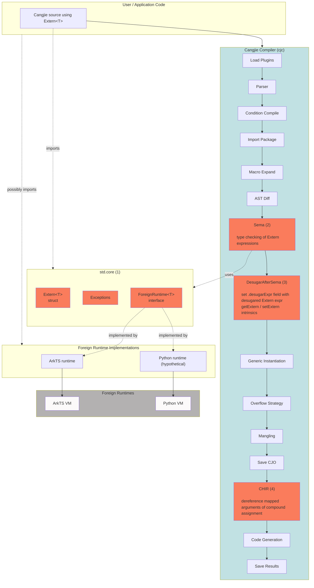

# Architecture/Feature Design Document: Cangjie `Extern<T>` Type

**Feature:** Language-level dynamic interoperability via `Extern<T>` and `ForeignRuntime<T>`

**Spec:** [The Cangjie Extern type](https://wiki.huawei.com/domains/4014/wiki/11230/WIKI2026040810696277)

---


## 1. Source and Value of Feature Requirements/Problems/Motivation

### Background

Existing interoperability mechanisms are language-specific, reflection-based, and require significant boilerplate. The `Extern<T>` feature addresses this by providing a lightweight, generic representation of foreign objects that enables direct interaction with external runtimes while keeping runtime-specific behavior encapsulated.

`Extern<T>` introduces a runtime-agnostic abstraction for references to values managed outside the Cangjie runtime. Rather than assuming a foreign object's type system or memory layout, Cangjie treats these values as opaque references and relies on the associated ForeignRuntime implementation to define conversion semantics and dynamic operations. This approach provides a lightweight alternative to wrapper-based interop while remaining extensible to multiple foreign runtimes.

The requirements for improved interop are captured in [Dynamic and gradual types for improved Cangjie–ArkTS interop](https://onebox.huawei.com/v/13b0bf0281118cb4b9ac3bd0366436eb?type=0) and the proposal document [The Cangjie Extern type](https://wiki.huawei.com/domains/4014/wiki/11230/WIKI2026040810696277). Together they motivate a language-level mechanism inspired by C# `dynamic`, but scoped explicitly to foreign runtimes rather than suspending all static typing.

### Before vs after (user perspective)

**Before** — reflection-based ArkTS interop:

```cangjie
func testCJ(runtime: JSContext, callInfo: JSCallInfo): Unit {
    let api = callInfo[0].asObject()
    let addF = api["add"].asFunction()
    let args = [runtime.number(2).toJSValue(), runtime.number(3.5).toJSValue()]
    let receiver = runtime.null().toJSValue()
    let result = addF.call(args, thisArg: receiver).asNumber().toFloat64()
    println("Result: ${result}")
}
```

**After** — `Extern<T>` for some generic runtime `T`, e.g. ArkTS:

```cangjie
func testCJ(vm: Extern<T>): Unit where T <: ForeignRuntime<T> {
    let calculator: Extern<T> = vm.calculator
    let result: Float64 = T.fromExtern<Float64>(calculator.add(2, 3.5))
    println("Result: ${result}")
}
```

The syntactic sugar for `T.fromExtern<...>(...)` has not yet been decided and is outside the scope of this architecture. [Appendix A](#appendix-a) includes the initial forced-cast proposal, and [casts.md](https://github.com/CJPLUK/proposals/blob/main/casts.md) has a generic cast proposal to be discussed as a separate proposal.

### Design philosophy

`Extern<T>` is inspired by C# `dynamic` but deliberately scoped:

- `T` must implement `ForeignRuntime<T>` — the type parameter distinguishes runtimes.
- Cangjie makes no assumptions about foreign value layout; the runtime owns semantics.
- Dynamic features (member access, call, index) are compiler-desugared to static `ForeignRuntime` calls.
- Cangjie values are implicitly converted to `Extern<T>` when an `Extern<T>` is expected.
- `e: Extern<T>` needs to be explicitly converted to Cangjie through `T.fromExtern<U>(e)`.

### Major benefits

1. **Productivity:** Eliminate reflection-based API or IDLize-like approaches
2. **Ergonomics:** Idiomatic Cangjie syntax for member access, calls, and indexing on foreign values.
3. **Generality:** Same mechanism works for ArkTS, Python, SQL engines, JSON parsers, or any dynamically invocable evaluator.
4. **Safety vs `dynamic`:** `Extern<T>` is explicitly tied to runtime `T`, reducing the abuse surface of unconstrained dynamic typing.


---

## 2. Feature Impact Analysis <span id="feature-impact-analysis"></span>

### Position in the system <span id="position-in-the-system"></span>

Compilation stages according to [cangjie_compiler/src/Frontend/CompilerInstance.cpp](https://gitcode.com/Cangjie/cangjie_compiler/blob/main/src/Frontend/CompilerInstance.cpp).

This document is mostly about the boxes in red. More detailed information about the implementation can be found in [4. Detailed Implementation Plan](#4-detailed-implementation-plan).



### Changes 

| Component | Role |
| --- | --- |
| `cangjie_runtime` - std.core | (1) New file [`extern_runtime.cj`](https://github.com/CJPLUK/cangjie_runtime/compare/469f9ebc73959d3eb8d2b79b424aeceaf492bb94...feature_extern_simple_model#diff-515353015ae80d6a51e0732df3b0e55484e5d9beb4708440b17be668f06d370e) in `std.core` with `Extern<T>` struct, `ForeignRuntime<T>` interface, new exceptions, and documentation about new public declarations. Details in section [3.1. Standard library (`std.core`)](#31-standard-library-stdcore): [`Extern<T>` struct](#externt-struct), [`ForeignRuntime<T>` interface](#foreignruntimet-interface), [exceptions](#exception-hierarchy-all-in-stdcore). |
| `cangjie_compiler` - Sema | (2) Type checking of Extern expressions and annotate Extern expression that need desugaring. Typing rules in section [3.2.1. Type Checking Rules](#321-type-checking-rules). Implementation details in [4.1. Type checking](#41-type-checking). |
| `cangjie_compiler` - Desugar After Sema | (3) Additional pass to desugar annotated Extern expressions. Desugaring rules in section [3.2.2. Desugaring after sema](#322-desugaring-after-sema). Implementation details in [4.2. Desugaring](#42-desugaring). |
| `cangjie_compiler` - CHIR | (4) Dereference mapped call arguments, needed for compound assignment `x.f op= v` of a field `x.f: Extern<T>`. Details in [Compound assignment of an Extern variable or field](#compound-assignment-of-an-extern-variable-or-field). |
| `cangjie_tools` | Consequence of (1). Some LSP tests golden files need to be updated because of additional new public declarations in std.core. See golden files diffs in [GitCode PR](https://gitcode.com/Cangjie/cangjie_tools/pull/1355/diffs). |

No changes in the compiler backend or any specific OS-specific features.

---

## 3. High level design

Consider the following a motivational example for this section.

```cangjie
// vm: Extern<T>, T <: ForeignRuntime
let calculator : Extern<T> = vm.calculator
let sum        : Extern<T> = calculator.add(2, 3.5)
let result     : Float64   = T.fromExtern<Float64>(sum)
```

During compilation, the example above is desugared as follows.

```cangjie
let calculator : Extern<T> = T.memberAccess(vm, "calculator")
let sum        : Extern<T> = T.functionCall(T.memberAccess(calculator, "add"), [2, 3.5])
let result     : Float64   = T.fromExtern<Float64>(sum)
```

The compiler desugars Extern typed expressions directly into calls to `ForeignRuntime` static functions.

Section 3.1 introduces the changes to standard library core, and Section 3.2 introduces the changes required in the compiler.

### 3.1 Standard library (`std.core`) <span id="31-standard-library-stdcore"></span>

We introduce a **new file**: `stdlib/libs/std/core/extern_runtime.cj` containing the following definitions.

#### `Extern<T>` struct <span id="externt-struct"></span>

```cangjie
@Intrinsic
func getExtern<T>(e: Extern<T>): Any where T <: ForeignRuntime<T>

@Intrinsic
func setExtern<T>(e: Extern<T>, payload: Any): Unit where T <: ForeignRuntime<T>

public struct Extern<T> where T <: ForeignRuntime<T> {
    private var payload: Any = ()

    public Extern(payload: Any) {
        setExtern(this, payload)
    }
    public static func getPayload(e: Extern<T>): Any {
        getExtern(e)
    }
}
```

The property `Extern<T>.getPayload(Extern<T>(v)) = v` holds for any value `v: Any` and `T <: ForeignRuntime<T>`.

The default payload makes `this` fully initialized before the constructor body runs. After Sema, the compiler desugars `getExtern` and `setExtern` into direct field reads and writes.

#### `ForeignRuntime<T>` interface <span id="foreignruntimet-interface"></span>

```cangjie
public interface ForeignRuntime<T> where T <: ForeignRuntime<T> {
    static func memberAccess(e: Extern<T>, field: String): Extern<T>
    static func indexedAccess(e: Extern<T>, arg: Any): Extern<T>

    static func memberUpdate(e: Extern<T>, field: String, value: Any): Unit
    static func indexedUpdate(e: Extern<T>, field: Any, value: Any): Unit

    static func functionCall(e: Extern<T>, args: Array<Any>): Extern<T>

    static func fromExtern<R>(h: Extern<T>): R
    static func toExtern<R>(v: R): Extern<T>
}
```

#### Exceptions (all in `std.core`) <span id="exception-hierarchy-all-in-stdcore"></span>

| Exception | When raised |
| --- | --- |
| `ExternMemberAccessException` | Non-existing member access/update |
| `ExternFunctionAccessException` | Non-existing function access |
| `ExternFunctionCallException` | Wrong arguments to function call |
| `ExternIndexedAccessException` | Wrong index or out-of-bounds |
| `ExternConversionException` | `fromExtern` / `toExtern` conversion failure |
| `ForeignRuntimeException` | Foreign runtime throws (includes foreign stack trace) |


#### API contract <span id="api-contract"></span>

`ForeignRuntime` implementers **must** implement the following functions:

1. `static func fromExtern<R>(e: Extern<T>): R`
    - must throw `ExternConversionException` if a conversion exception occurs.
2. `static func toExtern<R>(v: R): Extern<T>`
    - must throw `ExternConversionException` if a conversion exception occurs.
3. `static func memberAccess(e: Extern<T>, field: String): Extern<T>`
    - must throw `ExternMemberAccessException` for a non-existing member.
4. `static func indexedAccess(e: Extern<T>, arg: Any): Extern<T>`
    - must throw `ExternIndexedAccessException` for a wrong index.
5. `static func memberUpdate(e: Extern<T>, field: String, value: Any): Unit`
    - must throw `ExternMemberAccessException` for a non-existing member.
6. `static func indexedUpdate(e: Extern<T>, field: Any, value: Any): Unit`
    - must throw `ExternIndexedAccessException` for a wrong index.
7. `static func functionCall(e: Extern<T>, args: Array<Any>): Extern<T>`
    - must throw `ExternFunctionCallException` for wrong arguments.

These functions must throw `ForeignRuntimeException` if execution in the external runtime throws an exception.

**Example**: The class below is a simple example to demonstrate a Foreign Runtime that type checks. Every required function is declared with its signature, as in the `ForeignRuntime<T>` interface, and the body of each function simply throws rather than interacting with an external runtime.

```cangjie
public class MockRT <: ForeignRuntime<MockRT> {
    public static func memberAccess(e: Extern<MockRT>, field: String): Extern<MockRT> { throw ExternMemberAccessException("Member not found") }
    public static func indexedAccess(e: Extern<MockRT>, arg: Any): Extern<MockRT> { throw ExternIndexedAccessException("Invalid index") }
    public static func memberUpdate(e: Extern<MockRT>, field: String, value: Any): Unit { throw ExternMemberAccessException("Member not found") }
    public static func indexedUpdate(e: Extern<MockRT>, field: Any, value: Any): Unit { throw ExternIndexedAccessException("Invalid index") }
    public static func functionCall(e: Extern<MockRT>, args: Array<Any>): Extern<MockRT> { throw ExternFunctionAccessException("Function not found") }
    public static func fromExtern<R>(e: Extern<MockRT>): R { throw ExternConversionException("Unsupported conversion") }
    public static func toExtern<R>(v: R): Extern<MockRT> { throw ExternConversionException("Unsupported conversion") }
}
```

### 3.2 Compiler changes


#### 3.2.1 Type checking rules

##### Extensions of `Extern`

An extension targeting `Extern<T>` is a type error, including through a type alias.

Examples:

```cangjie
extend<T> Extern<T> where T <: ForeignRuntime<T> {}

type ForeignValue<T> = Extern<T>
extend<T> ForeignValue<T> where T <: ForeignRuntime<T> {}
```

Both extensions report:

```bash
error: extending type 'Struct-Extern<Generics-T>' is not allowed
```

##### Implicit conversion

When `Extern<T>` is expected in a context that allows implicit conversion (listed below), accept a well-typed expression `exp: U` and retain `U` for later desugaring into `T.toExtern<U>(exp)`, if needed. Values that are already of type `Extern<T>` need no conversion.

| Context | Rule | Example |
|---|---|---|
| Initializer | declared type | `let x: Extern<T> = exp` |
| Assignment | type of the left-hand side variable | `x = exp` |
| Call argument | parameter type | `f(exp)` |
| Return | return type of the function | `return exp` |
| Function or lambda body | return type, for the last expression | `func f(): Extern<T> { exp }` |
| Default parameter value | parameter type | `func f(p!: Extern<T> = exp) {}` |
| Array or tuple literal element | element type of the literal | `let arr: Array<Extern<T>> = [exp1, exp2]`, `let tpl: (Extern<T>, Int64) = (exp, 1)` |

Implicit conversions play no part in overload resolution: a candidate whose parameter is `Extern<T>` is ranked by the usual most-specific rule, whether or not its argument needs a conversion. So a call is ambiguous when one candidate needs a conversion, another one does not, and neither is more specific.

Examples of well typed expressions and type errors:

```cangjie
let x: Int64 = 42
let u: Extern<R> = ()    // OK, the unit value will be converted
let e: Extern<R> = x     // OK, x will be converted

func f(p: Extern<R>) { ... }
func g(): Int64 { 1 }

// Contexts
var a: Extern<R> = e                              // OK, no conversion needed
a = "s"                                           // OK, "s" will be converted
f(x + 1)                                          // OK, x + 1 will be converted
func h1(): Extern<R> { return 1 }                 // OK, 1 will be converted
func h2(): Extern<R> { x }                        // OK, x will be converted
let l: () -> Extern<R> = { => x }                 // OK, x will be converted
func h3(p!: Extern<R> = 1) {}                     // OK, default value will be converted
func h4(): Extern<R> { throw Exception() }        // OK, Nothing needs no conversion

// Literals
let b: Array<Extern<R>> = [x, "s"]                // OK, each element will be converted
let t: (Extern<R>, Int64) = (x, 1)                // OK, x will be converted
let n: Array<Array<Extern<R>>> = [[1], ["s"]]     // OK, 1 and "s" will be converted
let c: Extern<R> = [x, 12]                        // OK, whole literal will be converted

// Expressions made of blocks of code
let d: Extern<R> = if (x > 0) { 1 } else { 2 }    // OK, the if will be converted
let m: Extern<R> = match (x) {                    // OK, the match will be converted
    case 0 => "zero"
    case _ => "other"
}
let tc: Extern<R> = try { x } catch (_: Exception) { 0 }  // OK, the try will be converted

// No conversion
let ints: Array<Int64> = [3]
let arr: Array<Extern<R>> = ints                  // type error: expected Array<Extern<R>>, found Array<Int64>
let fn: () -> Extern<R> = g                       // type error: expected () -> Extern<R>, found () -> Int64
match (e) {
    case 5 => ()                                  // type error: expected Extern<R>, found Int64
    case _ => ()
}

// Overload resolution
func k(p: Int64) {}
func k(p: Extern<R>) {}
k(1)                                              // type error: ambiguous, neither Int64 nor Extern<R> is more specific
func m(p: Any) {}
func m(p: Extern<R>) {}
m(1)                                              // OK, calls m(p: Extern<R>), more specific than Any; 1 will be converted
```

##### Dynamic operations

For a value `e: Extern<T>`, dynamic field accesses, dynamic index accesses, and dynamic calls have type `Extern<T>`, while dynamic updates have type `Unit`.

| Operation | Rule | Result type |
|---|---|---|
| `e.f` | No compile-time check on field `f`. | `Extern<T>` |
| `e[idx]` | Index must be well-typed expressions of `Any` type. | `Extern<T>` |
| `e(a1, ..., an)` | Arguments must be well-typed expressions of `Any` type; named and `inout` arguments are rejected. | `Extern<T>` |
| `e.f = v`, `e[idx] = v`, `e.f op= v`, `e[idx] op= v` | `idx` and `v` must be well-typed expressions of `Any` type. | `Unit` |

Indices, arguments and update values do not implicitly call `toExtern`. Assignment to an `Extern<T>` variable follows ordinary assignment rules. Operators rewritten as member calls follow the dynamic-call rules. Multiple assignment checks each update independently.

Examples, with `e: Extern<R>` and `x: Int64`:

```cangjie
e.f                      // type Extern<R>
e.f.g.h                  // type Extern<R>; each member access is dynamic, no compile-time check on fields `f`, `g`, `h`.
e[0]["k"]                // type Extern<R>
e(1, "a")                // type Extern<R>; e is called as a function
e.f(1, "a")              // type Extern<R>; arguments will not be converted
e.f(1)(2)                // type Extern<R>; the result is called again
e.f { => 1 }             // type Extern<R>; the trailing lambda is an argument
e.f(e.g)                 // type Extern<R>;
e.f = e.g                // type Unit
e[0] = "a"               // type Unit; value will not be converted
e.f += 1                 // type Unit; literal 1 will not be converted
e[0] += 1                // type Unit
(e.f, e[0]) = (1, "a")   // each update is checked independently
e + 1                    // type Extern<R>; desugared as `e.+(1)`
let i: Int64 = e.f       // type error: no implicit conversion from Extern<R>
if (e < 1) {}            // type error: condition must be Bool
e.f(p: 1)                // type error: named arguments are rejected
e.f(inout x)             // type error: inout arguments are rejected
```

#### 3.2.2 Desugaring after SEMA

##### Implicit conversion to `Extern<T>` <span id="implicit-conversion-to-externt"></span>

When `Extern<T>` is expected, an expression `exp` of type `U` becomes `T.toExtern<U>(exp)` if `U` is neither `Extern<T>` nor `Nothing`. The contexts where such a conversion is inserted are listed under [Implicit conversion](#implicit-conversion).

Examples:
Assume `cjexp` has type `U` with `U != Extern<T>`. Then:

```cangjie
let x: Extern<R> = cjexp
// ~> 
// let x: Extern<R> = R.toExtern<U>(cjexp)

func foo(..., x: Extern<R>, ...) {...}
foo(..., 42, ...)
// ~>
// foo(..., R.toExtern<Int64>(42), ...)

let x: Int64 = 42
let a: Array<Extern<R>> = [x, 12]
// ~> 
// let a: Array<Extern<R>> = [R.toExtern<Int64>(x), R.toExtern<Int64>(12)]

let b: Extern<R> = [x, 12]
// ~>
// let b: Extern<R> = R.toExtern<Array<Int64>>([x, 12])
```

##### Dynamic Extern expression desugaring

The desugaring of `Extern` expressions is performed according to the `DESUGAR` function defined below, where `~>` means "is defined as". Each dynamic operation becomes a direct static call to the corresponding `ForeignRuntime<T>` function.

```cangjie
DESUGAR(e1.f) ~> // if e1 has type Extern<T>
    T.memberAccess(DESUGAR(e1), "f")
DESUGAR(e1.f = e2) ~> // if e1 has type Extern<T>
    T.memberUpdate(DESUGAR(e1), "f", DESUGAR(e2))
DESUGAR(e1[e2]) ~> // if e1 has type Extern<T>
    T.indexedAccess(DESUGAR(e1), DESUGAR(e2))
DESUGAR(e1[e2] = e3) ~> // if e1 has type Extern<T>
    T.indexedUpdate(DESUGAR(e1), DESUGAR(e2), DESUGAR(e3))
DESUGAR(e1(e2, e3, ...)) ~> // if e1 has type Extern<T>
    T.functionCall(DESUGAR(e1), [DESUGAR(e2), DESUGAR(e3), ...])
DESUGAR(e1.f op= e2) ~> // if e1 has type Extern<T>
    let tmp1 = DESUGAR(e1)
    let tmp2 = T.memberAccess(T.memberAccess(tmp1, "f"), "op")
    T.memberUpdate(tmp1, "f", T.functionCall(tmp2, [DESUGAR(e2)]))
DESUGAR(e1[e2] op= e3) ~> // if e1 has type Extern<T>
    let tmp1 = DESUGAR(e1)
    let tmp2 = DESUGAR(e2)
    let tmp3 = T.memberAccess(T.indexedAccess(tmp1, tmp2), "op")
    T.indexedUpdate(tmp1, tmp2, T.functionCall(tmp3, [DESUGAR(e3)]))
DESUGAR(lhs op= e2) ~> // if lhs: Extern<T> is a variable or a field of a non-Extern value
    lhs = DESUGAR(lhs`.op(e2)) // lhs` is mapped to lhs so its receiver is evaluated only once
DESUGAR(base) ~> // expressions without smaller subexpressions are preserved as they are
    base
DESUGAR(exp) ~> // otherwise, preserve structure and desugar subexpressions
    MAP(DESUGAR, exp)
```


For non-`Extern` Cangjie expressions, `MAP(DESUGAR, exp)` preserves the outer expression and desugars its subexpressions..

The compound-assignment rules are discussed in detail in [Section 3.2.3, Compound Assignment](#compound-assignment). Here `"op"` denotes the operator name without `=` (e.g. `"+"` for `+=`), and the temporaries are fresh names.

The generated calls follow standard Cangjie evaluation order. Compound-assignment expansions use temporaries so that the receiver and index are evaluated only once.

Example 1:

For `e1: Extern<T>`.

```cangjie
DESUGAR(e1.x.y) ~> T.memberAccess(T.memberAccess(e1, "x"), "y")
```

Example 2:

For `e1, e2: Extern<T>`.

```cangjie
DESUGAR(e1.x.y = e2.z) ~>
    T.memberUpdate(
        T.memberAccess(e1, "x"),
        "y",
        T.memberAccess(e2, "z")
    )
```

Example 3:

For `e1, e2: Extern<T>`.

```cangjie
DESUGAR(e1.x += e2) ~>
    let tmp1 = e1
    let tmp2 = T.memberAccess(T.memberAccess(tmp1, "x"), "+")
    T.memberUpdate(tmp1, "x", T.functionCall(tmp2, [e2]))
```

Example 4:

For `e1, e2: Extern<T>`.

```cangjie
DESUGAR(e1.a[e2.b]) ~>
    T.indexedAccess(
        T.memberAccess(e1, "a"),
        T.memberAccess(e2, "b")
    )
```

Example 5:

For `e1, e2, e3: Extern<T>`.

```cangjie
DESUGAR(e1.a[e2.b] = e3.c) ~>
    T.indexedUpdate(
        T.memberAccess(e1, "a"),
        T.memberAccess(e2, "b"),
        T.memberAccess(e3, "c")
    )
```

Example 6:

For `e1, e2, e3: Extern<T>`.

```cangjie
DESUGAR(e1.a[e2].b -= e3.c) ~>
    let tmp1 = T.indexedAccess(T.memberAccess(e1, "a"), e2)
    let tmp2 = T.memberAccess(T.memberAccess(tmp1, "b"), "-")
    T.memberUpdate(tmp1, "b", T.functionCall(tmp2, [T.memberAccess(e3, "c")]))
```

Example 7:

For `e1, e2, e3: Extern<T>`, `n: Int64`.

```cangjie
DESUGAR(e1.a.b(e2.c, e3[0], n + 1)) ~>
    T.functionCall(
        T.memberAccess(T.memberAccess(e1, "a"), "b"),
        [ T.memberAccess(e2, "c"),
          T.indexedAccess(e3, 0),
          n + 1
        ]
    )
```

#### 3.2.3 Other forms of assignment

##### Multiple Assignment Expression <span id="multiple-assignment-expression"></span>

Multiple assignment of the form `(x1, ..., x3) = ...` remains consistent with the current specification/implementation. This occurs naturally because the desugaring of multiple assignment occurs before the desugaring of Extern.

##### Compound Assignment <span id="compound-assignment"></span>

Compound assignment to a dynamic member or index needs an explicit read/call/write expansion. We desugar compound assignments as follows, depending on the shape of the left-hand side expression. Each result has type `Unit`; the receiver and index are evaluated only once, and the right-hand side is passed without an implicit `toExtern` conversion.

###### Case 1

Let `lhs: Extern<T>` be a mutable variable, or a non-dynamic extern operation of type `Extern<T>` (e.g. `foo.f1.e2` of type `Extern<T>`, where `foo` and `foo.f1` are not of non-Extern type) and `cjexp` of any type, then:

```cangjie
lhs += cjexp
```

is desugared into

```cangjie
lhs = T.functionCall(T.memberAccess(lhs', "+"), [cjexp])
```

``lhs'`` above represents a reference to the expression ``x'``. Compiler already has support for this.

###### Case 2

Let `e1: Extern<T>` then:

```cangjie
e1.foo += exp
```

is desugared into

```cangjie
let tmp1 = e1
let tmp2 = T.memberAccess(T.memberAccess(tmp1, "foo"), "+")
T.memberUpdate(tmp1, "foo", T.functionCall(tmp2, [exp]))
```

###### Case 3

Let `e1: Extern<T>` then:

```cangjie
e1[idx] += exp
```

is desugared into

```cangjie
let tmp1 = e1
let tmp2 = idx
let tmp3 = T.indexedAccess(tmp1, tmp2)
let tmp4 = T.memberAccess(tmp3, "+")
T.indexedUpdate(tmp1, tmp2, T.functionCall(tmp4, [exp]))
```

The same expansions apply to other compound operators, using the operator name without `=` (e.g. `"-"` for `-=`), and to any well-typed right-hand side. Any dynamic subexpressions in the receiver, index or right-hand side are recursively desugared.

---

## 4. Detailed Implementation Plan

Section 3 defined which `Extern` expressions the compiler accepts and what they are rewritten into. This section
describes how that is implemented in `cjc`.

The work is split between two stages: Sema only accepts the implicit
conversions and dynamic operations and gives them their types, without rewriting anything; the desugaring after Sema
then rewrites the `getExtern` and `setExtern` intrinsics used inside `Extern<T>` into payload field access/update as part of `DesugarIntrinsicCallExpr`; and the
new `DesugarExtern` pass rewrites the dynamic operations and implicit conversions in one pass, driven by the final types.

The only changes in CHIR are in the translation of mapped values needed by compound assignment (see
[Compound assignment of an Extern variable or field](#compound-assignment-of-an-extern-variable-or-field) and
[Compound assignment of an index with Extern subscript operators](#compound-assignment-of-an-index-with-extern-subscript-operators)).


Stages after CHIR are unchanged.

The section is organized as follows:
- [4.1. Type checking](#41-type-checking): the Sema changes.
- [4.2. Desugaring](#42-desugaring): the new `DesugarExtern` pass and the ASTs it generates.
- [4.3. Helpers](#43-helpers): functions shared by Sema and `DesugarExtern`.
- [4.4. Desugaring of `getExtern` and `setExtern`](#44-desugaring-of-getextern-and-setextern): how the intrinsic functions `getExtern(e)` and `setExtern(e, v)` are desugared into accesses of the payload field.

### 4.1. Type checking

#### 4.1.1. `Extern` cannot be extended

Extending `Extern` should result in a type error.

`CheckExtendedTypeValidity` in [TypeCheckExtend.cpp](https://gitcode.com/Cangjie/cangjie_compiler/pull/2317/diffs#mr_src/Sema/TypeCheckExtend.cpp) should report `sema_illegal_extended_type` for `extend Extern<T>`, including through a type alias.

#### 4.1.2. Implicit conversions

##### Conversion in `Check`

Function `Check` in [`src/Sema/TypeChecker.cpp`](https://gitcode.com/Cangjie/cangjie_compiler/pull/2317/diffs#mr_src/Sema/TypeChecker.cpp) accepts an expression of any type when the target is `Extern<T>`.
A new branch is added before the per-node checks, after the target has been substituted with the solved type variables:

```cpp
bool TypeChecker::TypeCheckerImpl::Check(ASTContext& ctx, Ptr<Ty> target, Ptr<Node> node)
{
    ...
    if ... {
    } else if (NeedTryExternConversion(*realTarget, *node)) {
        chkRet = ChkWithExternConversion(*curCtx, *realTarget, *node);
    } else {
        ...
    }
    ...
}
```

`NeedTryExternConversion` selects every expression whose target is some `Extern<…>`:

```cpp
bool TypeChecker::TypeCheckerImpl::NeedTryExternConversion(const Ty& target, const Node& node) const
{
    return target.IsCoreExternType() && Is<Expr>(&node);
}
```

`ChkWithExternConversion` then checks it:

```cpp
bool TypeChecker::TypeCheckerImpl::ChkWithExternConversion(ASTContext& ctx, Ty& target, Node& node)
{
    ctx.targetTypeMap[&node] = nullptr;
    bool isWellTyped = Ty::IsTyCorrect(Synthesize({ctx, SynPos::EXPR_ARG}, &node)) && ReplaceIdealTy(node);
    node.SetTy(typeManager.TryGreedySubst(node.GetTy()));
    if (!isWellTyped || !Ty::IsTyCorrect(node.GetTy()) || node.GetTy()->HasPlaceholder()) {
        return false;
    }
    // A known Extern<T> accepts any value.
    if (!target.HasPlaceholder()) {
        return true;
    }
    // Extern<R>, where R is to be inferred, accepts values of other types without constraining R.
    if (!node.GetTy()->IsCoreExternType()) {
        return true;
    }
    // A value of type Extern<T> is not converted and determines R in the target Extern<R>.
    return typeManager.IsSubtype(node.GetTy(), &target);
}
```

The function types the expression on its own, rejects it if that type is unusable, and then applies one rule with
three cases.

**Typing the expression on its own.**

- `ctx.targetTypeMap[&node] = nullptr` erases any expected type recorded for the node, so the expression is typed by
  itself and not as `Extern<…>`. Its own type `U` is what `DesugarExtern` later uses to generate `T.toExtern<U>(e)`.
- `Synthesize` computes `U` in argument position. `ReplaceIdealTy` turns a literal's provisional type into its default
  type, for example `1` into `Int64`. `isWellTyped` is false if either step fails.
- `TryGreedySubst` replaces type variables in `U` that the current inference has already solved. If `U` came out as
  `Box<T'>` and `T'` is known to be `Int64`, the node gets `Box<Int64>`.

**Rejecting unusable types.** The check fails if any of these holds:

| Condition | Meaning |
|---|---|
| `!isWellTyped` | Typing or literal defaulting failed, for example a type error inside the expression. |
| `!Ty::IsTyCorrect(node.GetTy())` | The resulting type is invalid. |
| `node.GetTy()->HasPlaceholder()` | `U` still contains unsolved type variables. `toExtern<U>` needs a fully known `U`, so the expression's type has to be fixed before it can be converted. |

**The rule.** A target type has a *placeholder* when it contains a type variable that inference is still solving,
such as the `R'` in `Extern<R'>`. The three remaining checks are applied in order:

1. `!target.HasPlaceholder()`: the expected type is concrete, like `Extern<RT>`. Accept every well-typed expression:
   - an `Int64`, a `String` or a lambda, which will be converted;
   - an `Extern<RT>` value, which needs no conversion;
   - an `Extern<RT2>` value, which is converted across runtimes;
   - `Nothing`, such as a `throw`, which `NeedExternConversion` never converts.
2. `!node.GetTy()->IsCoreExternType()`: the expected type is `Extern<R'>` and the expression isn't an Extern value,
   for example `1` or `[1]`. Accept it without constraining `R'`; the runtime must come from somewhere else.
3. `typeManager.IsSubtype(node.GetTy(), &target)`: the expected type is `Extern<R'>` and the expression is an Extern
   value, for example `e: Extern<RT>`. The subtype check succeeds only if `R'` can be `RT`, and it records that as a
   constraint for the solver. Values of type `Extern<T>` are the only way to determine the runtime.

**Correspondence with the solver.** During type argument inference, the constraint solver also accepts an argument
where its parameter type contains `Extern<T>`, through `AcceptsExternConversion` in
[`src/Sema/LocalTypeArgumentSynthesis.cpp`](https://gitcode.com/Cangjie/cangjie_compiler/pull/2317/diffs#mr_src/Sema/LocalTypeArgumentSynthesis.cpp).
The two must agree: inference may re-check an argument against its parameter type while some type variables are
still unsolved, and the base compiler assumes that this check succeeds when unification did.

The solver change is small. The argument pack gets a flag `externConversion`, set only while the arguments of a call
are matched against its parameters. `UnifyOne` then treats `argTy <: paramTy` as holding without constraints if one
side accepts the other by conversion, where neither `Nothing` nor a type with placeholders is ever accepted:
- an `Extern<T>` without placeholders, or a type without placeholders containing one, accepts any type, like case 1;
- `Extern<R'>` accepts any type that is not Extern, leaving `R'` unconstrained, like case 2. An `Extern<T>` argument
  goes through normal matching, which gives `R' = T`, like case 3.

The flag is off for the return type and for matching the bounds of a type variable against each other, where no value
is converted.

#### 4.1.3. Dynamic operations

A dynamic field access, index access, or call is typed `Extern<T>`, the type of its receiver. A dynamic field or index update, including compound assignment, is typed `Unit`.

| Source | Where | Rule |
|---|---|---|
| `e.f` | `InferMemberAccess` in [NameReferenceExpr.cpp](https://gitcode.com/Cangjie/cangjie_compiler/pull/2317/diffs#mr_src/Sema/TypeCheckExpr/NameReferenceExpr.cpp) | if `e: Extern<T>` then `ty = Extern<T>` |
| `e[idx]` | `ChkSubscriptExpr` in [SubscriptExpr.cpp](https://gitcode.com/Cangjie/cangjie_compiler/pull/2317/diffs#mr_src/Sema/TypeCheckExpr/SubscriptExpr.cpp)  |  if `e: Extern<T>` then `ty = Extern<T>`, `idx` has any valid type |
| `e(args)`, `e.f(args)` | `ChkCallExpr` in [TypeCheckCall.cpp](https://gitcode.com/Cangjie/cangjie_compiler/pull/2317/diffs#mr_src/Sema/TypeCheckCall.cpp), before candidate lookup | if `e: Extern<T>`/`e.f : Extern<T>` then `ty = Extern<T>`; arguments of any type; named and `inout` arguments are errors |
| `e.f = v`, `e[idx] = v`, `e.f op= v`, `e[idx] op= v` | `SynAssignExpr` in [AssignExpr.cpp](https://gitcode.com/Cangjie/cangjie_compiler/pull/2317/diffs#mr_src/Sema/TypeCheckExpr/AssignExpr.cpp), before operator overloading | if `e : Extern<T>` then `ty = Unit`; the left value has type `Extern<T>`; `v`, `idx` of any type |

The changes to these functions in pseudocode:

```cpp
InferMemberAccess(ma):                     // ma is e.f
    synthesize e
    if IsDynamicExternMemberAccess(ma):    // e is an Extern<T> value, e.f is not a left value
        ma.ty = e.ty                       // no member lookup, no target

ChkSubscriptExpr(se):                      // se is e[idx]
    synthesize e and the index             // already done for every subscript
    if IsDynamicExternSubscript(se):       // before the rewrite into e.[](idx)
        ChkExternSubscript(se):
            se.ty = e.ty

ChkCallExpr(ce):                           // ce is e(args) or e.f(args)
    synthesize the callee e                // a dynamic callee e.f is accepted as it is
    if IsDynamicExternCall(ce):            // before candidate lookup
        ChkExternCall(ce):                 // The arguments are passed to the foreign runtime as Array<Any>
                                           // they may have any type but cannot be named nor inout.
            report named and inout arguments
            synthesize the arguments without a target
            ce.ty = e.ty

SynAssignExpr(ae):                         // ae is a dynamic member/index update, including op=
    synthesize e                           // the receiver of the left value
    if IsDynamicExternUpdate(ae):          // before operator overloading
        SynExternUpdate(ae):               // The indices and the value are passed to the foreign runtime as Any,
                                           // so they may have any type.
            synthesize the index and v without a target
            ae.leftValue.ty = e.ty
            ae.ty = Unit
```

When one of these nodes is checked against an expected type, its result type must be compatible with that type, subject to the implicit-conversion rules above.

No other change is needed for:
- **Operators.** `e1 + e2` and `-e` are already rewritten into `e1.+(e2)` and `e.-()`, which are dynamic calls of type `Extern<T>`. Comparisons too: `e1 < e2` and `e1 == e2` become `e1.<(e2)` and `e1.==(e2)`, of type `Extern<T>`, so they cannot be the condition of an `if`: they are not `Bool`.
- **A multiple assignment `(e.x, b) = (1, 2)`,** which becomes one dynamic update per element.

One change is needed for the **pipeline `x |> e`**, which is desugared during type checking into `e(x)`. `TryDesugarFunctionCallExpr` in [DesugarInTypeCheck.cpp](https://gitcode.com/Cangjie/cangjie_compiler/pull/2317/diffs#mr_src/Sema/Desugar/DesugarInTypeCheck.cpp) rewrites a callee that is not a function into `e.()`, the operator `()`. It leaves an `Extern<T>` value (`IsExternValue`, section 4.3) unchanged, so `x |> e` is the dynamic call `e(x)` rather than a call of the dynamic member access `e.()`.

#### 4.1.4. `Extern` in `const` code

`CheckConstEvaluation` runs among the checks after Sema, before `DesugarExtern` inserts the `toExtern` calls and the runtime calls, so it cannot see them. Instead, `ConstEvaluationChecker` in [ConstEvaluationChecker.cpp](https://gitcode.com/Cangjie/cangjie_compiler/pull/2317/diffs#mr_src/Sema/ConstEvaluationChecker.cpp) finds the nodes that `DesugarExtern` will rewrite, using the same tests on the typed AST:

- **Dynamic operations.** `ChkExpr` reports `sema_extern_operation_in_const` and fails, before the usual check, when `IsDynamicExternOperation` (section 4.3) holds, the test that `DesugarExtern` also uses to find the operations it rewrites.
- **Implicit conversions.** A converted value keeps its own type, so a conversion is found by comparing a value with the type expected for it. `ChkNoExternConversion(value, expected)` reports `sema_extern_conversion_in_const` when `NeedExternConversion` (section 4.3) holds, the test that `DesugarExtern` also uses: `expected` is `Extern<T>` and the type of `value` is not a subtype of it. So `Extern<A>` used where `Extern<B>` is expected is a conversion.

### 4.2. Desugaring

#### 4.2.1. The pass

New file [ExternDesugaring.cpp](https://gitcode.com/Cangjie/cangjie_compiler/pull/2317/diffs#mr_src/Sema/Desugar/AfterTypeCheck/ExternDesugaring.cpp):

```cpp
void TypeCheckerImpl::DesugarExtern(ASTContext& ctx, Package& pkg);
```

It is called in `PerformDesugarAfterSema` in [AfterTypeCheck.cpp](https://gitcode.com/Cangjie/cangjie_compiler/pull/2317/diffs#mr_src/Sema/Desugar/AfterTypeCheck.cpp):

```cpp
for (auto& pkg : pkgs) {
    PerformDesugarAfterTypeCheck(*ci->pkgCtxMap[pkg], *pkg);
    TryDesugarForCoalescing(*pkg);
    DesugarExtern(*ci->pkgCtxMap[pkg], *pkg); // new
    AutoBoxing autoBox(typeManager);
    autoBox.AddOptionBox(*pkg);
}
```

`PerformDesugarAfterSema` is the `DESUGAR_AFTER_SEMA` stage: after `SEMA`, before `GENERIC_INSTANTIATION` (see [CompilerInstance.cpp](https://gitcode.com/Cangjie/cangjie_compiler/blob/main/src/Frontend/CompilerInstance.cpp#L196) and [CompileStrategy.cpp](https://gitcode.com/Cangjie/cangjie_compiler/blob/main/src/Frontend/CompileStrategy.cpp#L57)). So generic bodies are rewritten once, including calls on a generic runtime `T`. The stage doesn't run when Sema reported errors.

| # | Pass | Before | After |
|---|---|---|---|
| 1 | `PerformDesugarAfterTypeCheck`: interop, declarations, and per-node rewrites such as `is`/`as`, ranges, string interpolation, intrinsic calls including `getExtern`/`setExtern` ([4.4](#44-desugaring-of-getextern-and-setextern)) | `e is T` | `match (e) { case _: T => true case _ => false }` |
| 2 | `TryDesugarForCoalescing` | `opt ?? 11` | `match (opt) { case Some(x) => x case None => 11 }` |
| 3 | `DesugarExtern` **(new)** | `let e: Extern<RT> = 1` | `let e: Extern<RT> = RT.toExtern<Int64>(1)` |
| 4 | `AutoBoxing::AddOptionBox` | `let o: ?Int64 = 1` | `let o: ?Int64 = Some(1)` |

`DesugarExtern` runs `ExternDesugaring::Run` ([ExternDesugaring.cpp](https://gitcode.com/Cangjie/cangjie_compiler/pull/2317/diffs#mr_src/Sema/Desugar/AfterTypeCheck/ExternDesugaring.cpp)): a single pre-order walk of the package, rewriting nodes by setting their `desugarExpr`:

```text
visit(node):
    if node is a dynamic expression:                 // section 4.2.3
        node.desugarExpr = direct runtime call or compound-assignment expansion
        visit(node.desugarExpr)                      // the cloned operands get desugared here
        skip the children of node                    // these are not used anymore, replaced by node.desugarExpr
    else:
        if node expects Extern<T> for a value e: U:   // section 4.2.2
            e.desugarExpr = T.toExtern<U>(e)
        visit the children of node
```

`visit` is the pre-visit callback of the AST `Walker`, called on the package and on every node it reaches.

#### 4.2.2. Implicit conversions

The pass converts a value `e: U` wherever `Extern<T>` is expected in the following cases:

| Node | Value `e` | Expected type | Example | Desugared |
|---|---|---|---|---|
| `VarDecl` | `initializer expression` | type of the declaration | `let x: Extern<RT> = 1` | `let x: Extern<RT> = RT.toExtern<Int64>(1)` |
| `AssignExpr` | `rightExpr` | type of `leftValue` | `x = "a"` | `x = RT.toExtern<String>("a")` |
| `CallExpr` | each argument | the matching parameter type of `baseFunc` | `f(1)` with `func f(p: Extern<RT>)` | `f(RT.toExtern<Int64>(1))` |
| `ReturnExpr` | `expr` | return type of the enclosing function | `return true` in `func g(): Extern<RT>` | `return RT.toExtern<Bool>(true)` |
| `FuncBody` | last expression of `body` | return type | `func g(): Extern<RT> { 1 }` | `func g(): Extern<RT> { RT.toExtern<Int64>(1) }` |
| `ArrayLit` of type `Array<E>` | each element | `E` | `let arr: Array<Extern<RT>> = [1, "a"]` | `let arr: Array<Extern<RT>> = [RT.toExtern<Int64>(1), RT.toExtern<String>("a")]` |
| `TupleLit` of type `(E1, ..., En)` | each component | `Ei` | `let tpl: (Extern<RT>, Int64) = (1, 2)` | `let tpl: (Extern<RT>, Int64) = (RT.toExtern<Int64>(1), 2)` |

```text
if NeedExternConversion(U, Extern<T>):
    e.desugarExpr = T.toExtern<U>(e.desugarExpr /* or a clone of e if e.desugarExpr == nullptr*/)
    e.ty          = Extern<T>
```

#### 4.2.3. Dynamic operations

A dynamic node is one of the expressions recognized by the `IsDynamicExtern*` predicates ([section 4.3](#43-helpers)). It becomes a direct static call to the corresponding `ForeignRuntime<T>` function. For example, `e.a.b(1)` becomes `T.functionCall(T.memberAccess(T.memberAccess(e, "a"), "b"), [1])`.

##### Rewriting dynamic nodes

The walk visits parents before children. It replaces each dynamic node with a runtime call containing clones of its operands, then visits those operands through the replacement:

```text
visit(node):
    if node is dynamic:
        node.desugarExpr = direct runtime call or compound-assignment expansion
        visit(node.desugarExpr)      // recursively desugar dynamic operations in the operands
        skip the children of node   // only the replacement is used
    else:
        visit the children of node
```

In `e.a.b(1)`, the call is replaced first, then `e.a.b` and `e.a` become nested runtime calls: `T.functionCall(T.memberAccess(T.memberAccess(e, "a"), "b"), [1])`. In `f(e.a)`, the normal Cangjie call is preserved and its argument becomes `T.memberAccess(e, "a")`.

##### Compound assignment of an Extern variable or field

Sema rewrites `lhs op= v`, with `lhs: Extern<T>` a variable or a field of a non-Extern value, into `lhs = lhs'.op(v)`, where `lhs'` is mapped to `lhs`. The pass turns `lhs'.op(v)` into `T.functionCall(T.memberAccess(lhs', "op"), [v])` and keeps the mapping, so `lhs` is evaluated once.

CHIR change, `TranslateTrivialArgWithNoSugar` in [TranslateCallExpr.cpp](https://gitcode.com/Cangjie/cangjie_compiler/pull/2317/diffs#mr_src/CHIR/AST2CHIR/TranslateASTNode/TranslateCallExpr.cpp): for a field, the mapped value is a reference, so a mapped argument is dereferenced with `GetDerefedValue`.

##### Compound assignment of an index with Extern subscript operators

Sema rewrites `c[i] op= v`, `c[i]++` and `c[i]--`, with `c` of a non-Extern type, into `c.[](i, value: c.[](i').op(v))`, where `i'` is mapped to `i`. Each operator that takes `Extern<T>` converts its own copy of `i`, so `i` is shared before the conversion:

```cangjie
class C {
    operator func [](index: Extern<RT>): Int64 { ... }
    operator func [](index: Extern<RT>, value!: Int64): Unit { ... }
}
func next(): Int64 { ... }

c[next()] += 1   // c.[](RT.toExtern(next()), value: c.[](RT.toExtern(next()')).+(1))
                 // next() runs once, RT.toExtern twice
```

| Index | Shared value | `toExtern` calls |
|---|---|---|
| `i`, both operators take `Extern<T>` | `i` | 2 |
| `i`, one operator takes `Extern<T>` | `i` | 1 |
| `T.toExtern(i)`, written by the user | `T.toExtern(i)` | 1 |

Changes:
- `TryConvert`: `i'` is mapped to the operand of the conversion of `i`, on its innermost `desugarExpr`, where CHIR reads it.
- `ProcessMapExpr` in [TranslateCallExpr.cpp](https://gitcode.com/Cangjie/cangjie_compiler/pull/2317/diffs#mr_src/CHIR/AST2CHIR/TranslateASTNode/TranslateCallExpr.cpp): when the setter's index is converted, the operand's value is cached for `i'`.

##### Compound assignment of a dynamic member or index

For `e.f op= v` or `e[i] op= v` with `e: Extern<T>`, `BuildCompoundAssignment` in [ExternDesugaring.cpp](https://gitcode.com/Cangjie/cangjie_compiler/pull/2317/diffs#mr_src/Sema/Desugar/AfterTypeCheck/ExternDesugaring.cpp) creates the `Unit` block of [Compound Assignment](#compound-assignment), cases 2 and 3, with `BuildMemberCompoundUpdate`, `BuildIndexedCompoundUpdate` and `CreateCompoundOpCall`.

### 4.3. Helpers

- `Ty::IsCoreExternType()` in [Types.h](https://gitcode.com/Cangjie/cangjie_compiler/pull/2317/diffs#mr_include/cangjie/AST/Types.h) / [Types.cpp](https://gitcode.com/Cangjie/cangjie_compiler/pull/2317/diffs#mr_src/AST/Types.cpp): a struct of the core package named `Extern` with one type argument. It uses the new constants `STD_LIB_EXTERN` and `STD_LIB_FOREIGN_RUNTIME` from [ConstantsUtils.h](https://gitcode.com/Cangjie/cangjie_compiler/pull/2317/diffs#mr_include/cangjie/Utils/ConstantsUtils.h).

- `NeedExternConversion(typeManager, from, to)` in [TypeCheckUtil.h](https://gitcode.com/Cangjie/cangjie_compiler/pull/2317/diffs#mr_src/Sema/TypeCheckUtil.h) / [TypeCheckUtil.cpp](https://gitcode.com/Cangjie/cangjie_compiler/pull/2317/diffs#mr_src/Sema/TypeCheckUtil.cpp), shared by the const checker and the desugaring:
  ```cpp
  // `to` is `Extern<T>`, `from` is a valid type, not `Nothing`, and not a subtype of `to`
  bool NeedExternConversion(TypeManager& typeManager, Ty& from, Ty& to);
  ```
- Dynamic-node predicates in [TypeCheckUtil.h](https://gitcode.com/Cangjie/cangjie_compiler/pull/2317/diffs#mr_src/Sema/TypeCheckUtil.h) / [TypeCheckUtil.cpp](https://gitcode.com/Cangjie/cangjie_compiler/pull/2317/diffs#mr_src/Sema/TypeCheckUtil.cpp), shared by Sema and the desugaring:
  ```cpp
  // e is a value of type Extern<T>, not the type name Extern<T> itself
  // (so Extern<T>.getPayload(e) is a normal static call, not a dynamic access)
  bool IsExternValue(const Expr& e);

  // ma is a read of any member f of an Extern<T> value e: e.f
  // (a left value e.f in e.f = v is handled by IsDynamicExternUpdate)
  bool IsDynamicExternMemberAccess(const MemberAccess& ma);

  // se is a read of an index of any type on an Extern<T> value e: e[i]
  // (a left value e[i] in e[i] = v is handled by IsDynamicExternUpdate)
  bool IsDynamicExternSubscript(const SubscriptExpr& se);

  // ae assigns to a member or to an index of an Extern<T> value e:
  // e.f = v, e[i] = v, e.f op= v, e[i] op= v
  bool IsDynamicExternUpdate(const AssignExpr& ae);

  // expr is one of the above and has no desugarExpr yet; used by DesugarExtern and the const checker
  bool IsDynamicExternOperation(const Expr& expr);
  ```

### 4.4. Desugaring of `getExtern` and `setExtern`

In `std.core`, Sema would type `this.payload` as a dynamic member access, so `Extern<T>` uses the intrinsics `getExtern` and `setExtern` instead. After Sema, `DesugarIntrinsicCallExpr` in [CallExpr.cpp](https://gitcode.com/Cangjie/cangjie_compiler/pull/2317/diffs#mr_src/Sema/Desugar/AfterTypeCheck/CallExpr.cpp) recognizes the two `std.core` intrinsics by name and calls `DesugarExternPayloadIntrinsic`, which sets the `desugarExpr` of the call:

| Call | Desugared | Type |
|---|---|---|
| `getExtern(e)` | `e.payload` | `Any` |
| `setExtern(e, v)` | `e.payload = v`, with `e.payload` marked `LEFT_VALUE` | `Unit` |

The member access is created with `CreateMemberAccess`, which binds its `target` to the `payload` declaration of `Extern<T>`. `IsDynamicExternMemberAccess` and `IsDynamicExternUpdate` ([section 4.3](#43-helpers)) only match member accesses without a target, so `DesugarExtern`, which runs later in the same stage ([section 4.2.1](#421-the-pass)), leaves these accesses unchanged. The translation to CHIR then handles them as ordinary struct field reads and writes. No new intrinsic kind is added to CHIR.

---

## 5. Runtime implementer possible optimizations

### Possible optimization 1: intern field names

```cangjie
e.foo
e.foo
// T.memberAccess(e, "foo")
// T.memberAccess(e, "foo")
```

A naive `memberAccess` converts the Cangjie string `"foo"` into a foreign string on every access. Interning it as a reusable foreign string removes that conversion from all later accesses of the same field name.

### Possible optimization 2: cache converted strings

```cangjie
let e1: Extern<T> = "foo"
let e2: Extern<T> = "foo"
// T.toExtern<String>("foo")
// T.toExtern<String>("foo")
```

A naive `toExtern` allocates and converts the same Cangjie string twice. Caching the foreign string keyed by the Cangjie value turns the second conversion into a lookup; the dual is `fromExtern<String>(e)` on the same immutable foreign string.

### Possible optimization 3: bulk conversion of aggregates

```cangjie
let a: Extern<T> = [1, 2, 3]
// T.toExtern<Array<Int64>>([1, 2, 3])
```

A naive `toExtern` builds the foreign array one element at a time. Copying the buffer in one go costs a single FFI call for the whole array; the dual is `fromExtern<Array<Int64>>(a)`.

---

## 6. Conclusion

The `Extern<T>` feature introduces a language-level interoperability mechanism that:

1. Replaces verbose reflection-based interop with idiomatic Cangjie syntax.
2. Desugars dynamic operations to static `ForeignRuntime<T>` calls at compile time.
3. Provides precise, typed exceptions for foreign operation failures.
4. Generalizes beyond ArkTS to any foreign runtime.

The compiler implementation ([Git code PR #1871](https://gitcode.com/Cangjie/cangjie_compiler/pull/2317)) adds `DesugarExtern.cpp` and Sema support, plus the forced cast parsing described in [Appendix A](#appendix-a). The standard library adds `Extern<T>`, `ForeignRuntime<T>`, and exception classes to `std.core`. CI validation has passed.

---

## Appendix A. Forced cast `(U)e` <span id="appendix-a"></span>

> **Out of review scope.** This appendix is part of the design but is not under discussion in this review.

A separate proposal, [Unified Casting](https://github.com/CJPLUK/proposals/blob/main/casts.md), introduces a unified
Cangjie cast `e as! U` that can replace the forced cast described here. `e as! U` has type `U` and throws a
`TypeConversionException` when the runtime type of `e` is not a subtype of `U`. It also subsumes the constructor-style
numeric conversions such as `UInt32(c)`. When `e: Extern<T>`, `e as! U` converts the value by calling
`T.fromExtern<U>(e)`, i.e. it has the semantics of `(U)e`. That proposal includes the removal of the forced cast `(U)e`
from `Extern`, which avoids the parsing ambiguity between `(U)e` and a call `(f)(x)` described in
[A.3](#appendix-a3), and the need for the `AmbiguousForcedCastExpr` node.

### A.1. Motivation <span id="appendix-a1"></span>

The forced cast `(U)e`, for `e: Extern<T>`, is a shorthand for the explicit conversion `T.fromExtern<U>(e)`. With it,
the motivational example of [section 3](#3-high-level-design) reads:

```cangjie
let result     : Float64   = (Float64)sum   // desugared to T.fromExtern<Float64>(sum)
```

### A.2. Impact <span id="appendix-a2"></span>

The forced cast is the only reason for the changes in the yellow boxes of the diagram in
[Position in the system](#position-in-the-system), and for the `ForcedCastExpr` class in `std.ast`.

| Component | Role |
| --- | --- |
| `cangjie_runtime` - std.ast | (2) New `ForcedCastExpr <: Expr` class. Class declaration, flatbuffers serialization. |
| `cangjie_compiler` - Parser | (3) Parse forced cast `(U)e` expressions as `ForcedCastExpr`. Note, that at this point we still don't know if we have a forced cast or a call expression of the form `(f)(x)` - this decision is postponed to SEMA. |
| `cangjie_compiler` - Macro Expand | (4) Add support for new ForcedCastExpr expressions, including flatbuffers serialization. |

### A.3. Parsing <span id="appendix-a3"></span>

Support for forced cast `(U)e` requires the addition of an AST node. At parsing time the syntax is ambiguous and the
parser cannot decide between a forced cast or a call expression of the form `(f)(x)` - this decision is postponed to
SEMA. We add `struct AmbiguousForcedCastExpr : Expr` which holds both readings to `include/cangjie/AST/Node.h`.

```cpp
struct AmbiguousForcedCastExpr : Expr {
    OwnedPtr<Type> type;      /**< `U` parsed as a type (null if not a valid type). */
    OwnedPtr<Expr> leftExpr;  /**< `U` parsed as an expression (null if not a valid expr). */
    OwnedPtr<Expr> rightExpr; /**< Operand, shared by both readings. */
    ...
}
```

Support for the new AST node needs to be added in the compiler macro stage. That includes adding support for it in the
serialization/deserialization process and also adding it to the Cangjie AST library.

A preliminary implementation can be found
[here](https://gitcode.com/alksjhdgf/cangjie_compiler_fc/commit/409039511add9fbef51ccc8991ab2c58d8b1ae31?ref=extern_forced_cast).

### A.4. Type checking <span id="appendix-a4"></span>

| Condition for `(U)e` | Rule |
|---|---|
| `U` resolves to a type and `e: Extern<T>` with `T <: ForeignRuntime<T>` | Accept; result type is `U`. |
| `U` resolves to a function and `e` is a parenthesized argument list | Check as an ordinary function call. |
| Neither reading succeeds | Type error. |

Examples, with `e: Extern<R>` and `f` a function:

```cangjie
(Int64)e    // forced cast; type Int64
(f)(e)      // ordinary function call
(Int64)1    // type error: operand is not Extern
```

### A.5. Desugaring <span id="appendix-a5"></span>

At the desugaring stage the remaining operations `(U)e` are not ambiguous anymore and can be desugared as `T.fromExtern<U>(DESUGAR(e))`, for `e: Extern<T>` and `T <: ForeignRuntime<T>`. Note that expressions `e` needs to be desugared, e.g. it can be of the form `e1.foo`. This adds one rule to the `DESUGAR` function of [section 3.2.2](#322-desugaring-after-sema):

```cangjie
DESUGAR((U)exp) ~>
    T.fromExtern<U>(DESUGAR(exp))
```

and one rewrite to the table of [section 4](#4-detailed-implementation-plan):

| Rewrite | Source | Result |
|---|---|---|
| Forced cast | `(U)e` with `e: Extern<T>` | `T.fromExtern<U>(DESUGAR(e))` |

In the `DesugarExtern` pass of [section 4.2.1](#421-the-pass), the forced cast is handled by a first branch of `visit`, before the dynamic expressions:

```text
visit(node):
    if node is a forced cast (U)e:
        node.desugarExpr = T.fromExtern<U>(clone(e))
        visit(node.desugarExpr)
        skip the children of node
    else if node is a dynamic expression:
        ...
```
